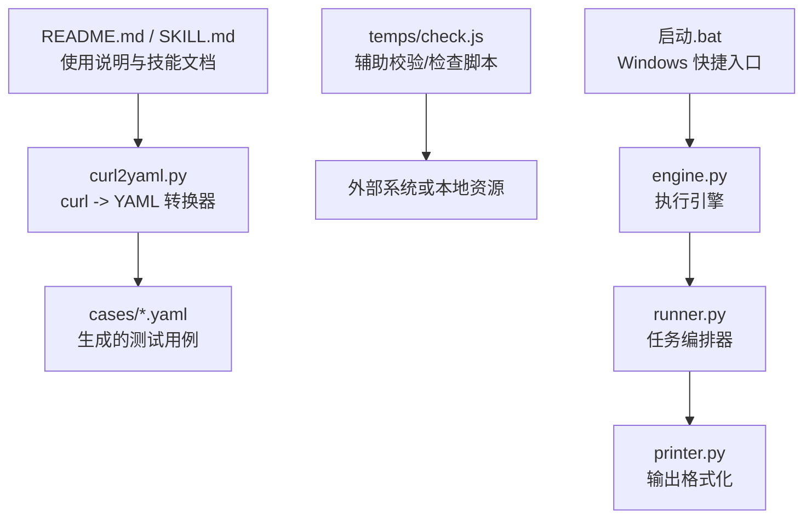
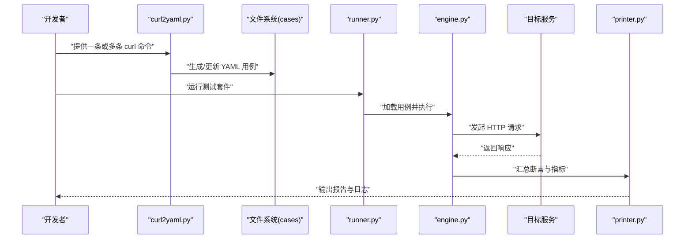
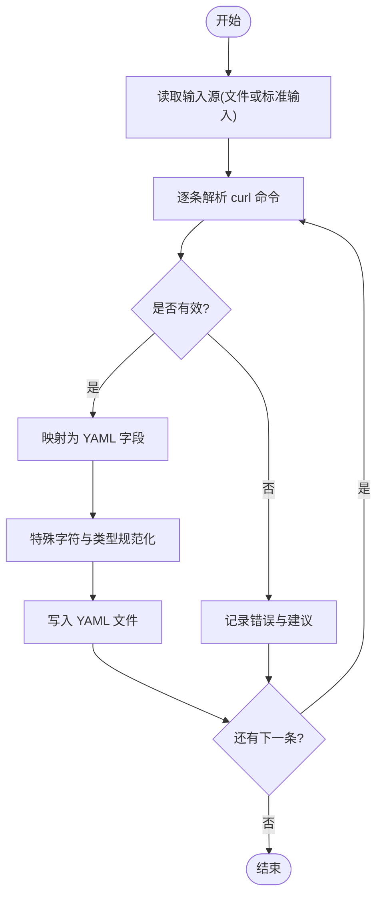
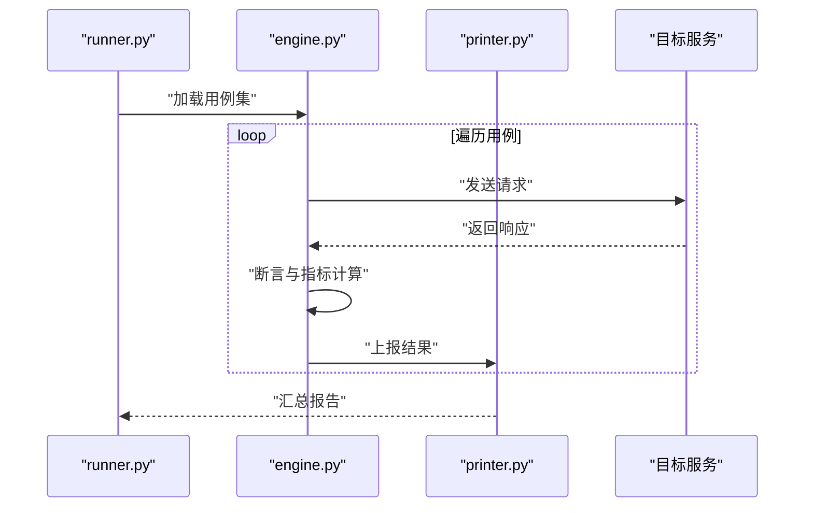
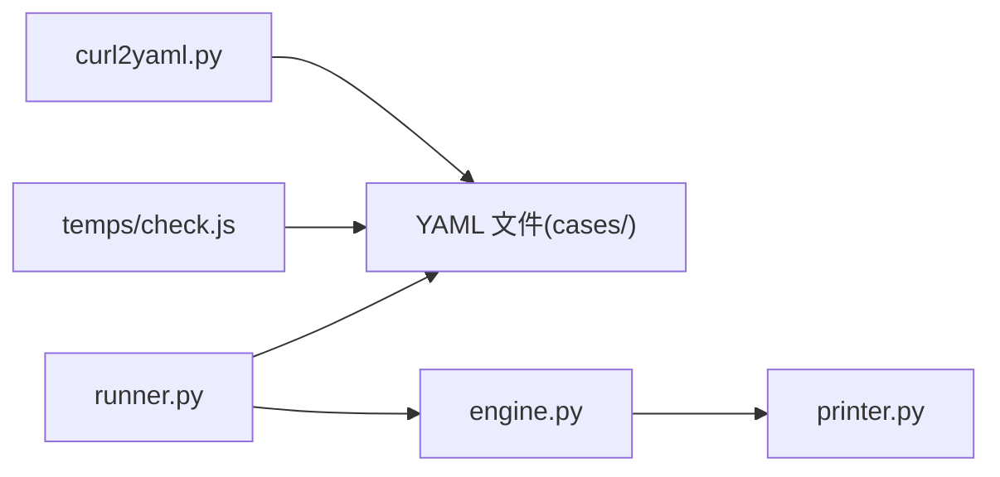

# 工具和实用程序

<cite>
**本文引用的文件**   
- [curl2yaml.py](file://curl2yaml.py)
- [check.js](file://temps/check.js)
- [README.md](file://README.md)
- [SKILL.md](file://SKILL.md)
- [engine.py](file://engine.py)
- [runner.py](file://runner.py)
- [printer.py](file://printer.py)
- [启动.bat](file://启动.bat)
</cite>

## 目录
1. [简介](#简介)
2. [项目结构](#项目结构)
3. [核心组件](#核心组件)
4. [架构总览](#架构总览)
5. [详细组件分析](#详细组件分析)
6. [依赖关系分析](#依赖关系分析)
7. [性能与稳定性考虑](#性能与稳定性考虑)
8. [故障排查指南](#故障排查指南)
9. [结论](#结论)
10. [附录](#附录)

## 简介
本手册聚焦于工具集与实用程序的使用说明，重点包括：
- curl2yaml.py：将现有 curl 命令转换为 YAML 测试用例的转换能力、参数映射策略、特殊字符处理与批量转换方法。
- temps/check.js：辅助脚本的功能定位与使用场景。
- 工具集成最佳实践：如何在 CI/CD 流水线中集成这些工具，以及常见问题与边界情况的处理方法。

## 项目结构
仓库根目录包含以下关键文件与目录：
- 转换与运行工具：curl2yaml.py、engine.py、runner.py、printer.py
- 辅助脚本：temps/check.js
- 示例与变量：cases/（含若干 .yaml 与 _variables.json）
- 文档与入口：README.md、SKILL.md、启动.bat

图表来源
- [curl2yaml.py](file://curl2yaml.py)
- [check.js](file://temps/check.js)
- [engine.py](file://engine.py)
- [runner.py](file://runner.py)
- [printer.py](file://printer.py)
- [启动.bat](file://启动.bat)
- [README.md](file://README.md)
- [SKILL.md](file://SKILL.md)

章节来源
- [README.md](file://README.md)
- [SKILL.md](file://SKILL.md)

## 核心组件
本节概述各组件的职责与交互方式，为后续深入分析提供框架。

- curl2yaml.py
  - 职责：解析 curl 命令行，提取请求方法、URL、头部、查询参数、表单数据、JSON 体、认证信息、超时等，并生成符合项目约定的 YAML 测试用例。
  - 输入：单条或多条 curl 命令（支持从文件或标准输入）。
  - 输出：YAML 文件（默认写入 cases/ 目录），可配置覆盖行为与命名规则。
  - 特性：支持批量转换、增量更新、错误诊断与回退策略。

- engine.py
  - 职责：加载 YAML 用例，驱动请求执行、断言与结果收集。
  - 与 runner.py 协作：由 runner.py 调度用例集合，engine.py 负责具体执行。

- runner.py
  - 职责：用例编排、并发控制、重试与失败聚合。
  - 与 printer.py 协作：通过 printer.py 统一输出报告与日志。

- temps/check.js
  - 职责：辅助校验或检查脚本，用于在转换前后对用例进行快速验证、连通性检查或环境准备。
  - 使用场景：CI 预检、本地快速回归、批量用例健康度检查。

章节来源
- [curl2yaml.py](file://curl2yaml.py)
- [engine.py](file://engine.py)
- [runner.py](file://runner.py)
- [printer.py](file://printer.py)
- [check.js](file://temps/check.js)

## 架构总览
下图展示从“curl 命令”到“YAML 用例”，再到“执行与报告”的整体流程。

图表来源
- [curl2yaml.py](file://curl2yaml.py)
- [runner.py](file://runner.py)
- [engine.py](file://engine.py)
- [printer.py](file://printer.py)

## 详细组件分析

### curl2yaml.py：curl 到 YAML 的转换器
- 功能要点
  - 参数解析：识别常用 curl 选项，如请求方法、URL、头部、查询参数、表单键值、JSON 体、认证头、超时、重定向、代理等。
  - 映射策略：将 curl 选项映射为 YAML 字段；当存在冲突或缺省值时采用明确的优先级规则。
  - 特殊字符处理：对 URL、Header、Body 中的引号、换行、Unicode、转义序列进行规范化，确保 YAML 合法且语义一致。
  - 批量转换：支持从文本文件读取多条 curl 命令，逐条转换并输出多个 YAML 文件，或合并为一个用例集。
  - 增量与覆盖：支持按用例名去重与覆盖写入，避免重复生成。
  - 错误诊断：对非法或不完整 curl 命令给出清晰提示，并提供修复建议。

- 典型用法
  - 单条转换：将一条 curl 命令转换为 YAML 用例。
  - 批量转换：从包含多条 curl 命令的文件批量生成用例。
  - 指定输出路径：自定义输出目录与命名规则。
  - 覆盖模式：允许覆盖已有用例，便于迭代更新。

- 支持的 curl 参数映射（概览）
  - 请求方法与 URL：由 curl 的基本语法与 -X/--request/-u/--url 等推导。
  - 头部：-H/--header 映射为请求头列表。
  - 查询参数：URL 中的 ?key=value 片段解析为查询参数。
  - 表单数据：-d/--data/--data-urlencode 映射为表单键值或 JSON 体。
  - 认证：-u/--user 映射为基本认证或相关头。
  - 超时与重试：--connect-timeout/--max-time 映射为超时配置。
  - 重定向：-L/--location 映射为重定向策略。
  - 代理：--proxy 映射为代理设置。
  - 其他：-v/--verbose 仅用于调试，不进入 YAML。

- 特殊字符处理原则
  - 字符串与数值：自动推断类型，必要时强制字符串化以避免精度丢失。
  - 转义与编码：对 URL 编码、JSON 转义、YAML 多行块进行规范化。
  - 空值与缺省：缺失字段采用合理默认值，保证用例可执行。

- 批量转换工作流

图表来源
- [curl2yaml.py](file://curl2yaml.py)

章节来源
- [curl2yaml.py](file://curl2yaml.py)

### temps/check.js：辅助校验与检查脚本
- 功能定位
  - 用例健康检查：在转换后快速扫描生成的 YAML 用例，检查必填字段、URL 可达性或基础格式正确性。
  - 环境预检：检查必要的外部依赖或环境变量是否存在。
  - 批量验证：对 cases/ 下的用例进行批量校验，输出摘要报告。

- 使用场景
  - 本地开发：在提交前快速自检用例质量。
  - CI/CD 预检：在构建阶段执行，阻断不合格的用例进入后续步骤。
  - 回归辅助：在大规模变更后进行用例一致性检查。

- 典型用法
  - 指定检查范围：针对单个用例或整个目录。
  - 严格模式：开启更严格的校验规则，发现潜在问题。
  - 输出格式：支持控制台摘要或结构化输出，便于集成。

章节来源
- [check.js](file://temps/check.js)

### 执行链路：engine.py、runner.py、printer.py
- 角色分工
  - runner.py：编排用例集合，管理并发、重试与失败聚合。
  - engine.py：加载 YAML 用例，构造请求、执行断言、收集指标。
  - printer.py：统一格式化输出，生成可读的报告与日志。

- 执行时序

图表来源
- [runner.py](file://runner.py)
- [engine.py](file://engine.py)
- [printer.py](file://printer.py)

章节来源
- [engine.py](file://engine.py)
- [runner.py](file://runner.py)
- [printer.py](file://printer.py)

## 依赖关系分析
- 内部依赖
  - curl2yaml.py 独立运行，主要依赖 Python 标准库与 YAML 序列化能力。
  - engine.py 与 runner.py 协同工作，printer.py 作为输出层被上层调用。
  - temps/check.js 独立于 Python 侧，通常由 Node.js 运行时执行。

- 外部依赖
  - 网络访问：engine.py 向目标服务发起 HTTP 请求。
  - 文件系统：读写 YAML 用例与日志。
  - 可选：Node.js 环境用于执行 check.js。

图表来源
- [curl2yaml.py](file://curl2yaml.py)
- [runner.py](file://runner.py)
- [engine.py](file://engine.py)
- [printer.py](file://printer.py)
- [check.js](file://temps/check.js)

章节来源
- [README.md](file://README.md)
- [SKILL.md](file://SKILL.md)

## 性能与稳定性考虑
- 批量转换
  - 分块处理：对大量 curl 命令分批解析与写入，降低内存占用。
  - 增量更新：基于用例名去重，避免重复生成。
  - 并行优化：在 CPU 密集环节可使用进程级并行（需评估 I/O 瓶颈）。

- 执行阶段
  - 并发控制：runner.py 应限制并发数，避免压垮目标服务。
  - 重试与退避：对瞬时失败进行指数退避重试。
  - 超时与熔断：设置合理的连接与读取超时，防止长时间阻塞。

- 输出与日志
  - 结构化日志：便于检索与聚合。
  - 报告压缩：在 CI 环境中归档精简报告，减少存储压力。

[本节为通用指导，无需特定文件引用]

## 故障排查指南
- 转换阶段常见问题
  - 非法或不完整 curl 命令：检查方法、URL 与必需参数；参考错误提示进行修正。
  - 特殊字符导致 YAML 非法：确认转义与编码是否正确；必要时使用多行块或显式字符串化。
  - 批量转换中断：查看中间日志，定位失败的命令并单独重试。

- 执行阶段常见问题
  - 网络不可达：检查代理、DNS 与防火墙策略；确认目标服务状态。
  - 认证失败：核对用户名/密码或令牌格式；确认头字段名称与大小写。
  - 断言失败：比对期望与实际响应，关注字段类型与顺序差异。

- 辅助脚本问题
  - Node.js 未安装或版本不符：安装兼容版本并重新执行。
  - 权限不足：确保对 cases/ 目录有读写权限。

章节来源
- [curl2yaml.py](file://curl2yaml.py)
- [check.js](file://temps/check.js)
- [engine.py](file://engine.py)
- [runner.py](file://runner.py)
- [printer.py](file://printer.py)

## 结论
- curl2yaml.py 提供了从 curl 到 YAML 的高效转换能力，支持批量处理与健壮的错误诊断。
- temps/check.js 作为轻量级辅助脚本，可在开发与 CI 中提升用例质量与环境稳定性。
- 结合 engine.py、runner.py 与 printer.py，形成从“用例生成—执行—报告”的闭环。
- 建议在 CI/CD 中引入转换与预检步骤，保障用例的一致性与可维护性。

[本节为总结性内容，无需特定文件引用]

## 附录
- 快速上手
  - 转换：使用 curl2yaml.py 将现有 curl 命令转换为 YAML 用例。
  - 检查：运行 temps/check.js 对用例进行快速校验。
  - 执行：通过 runner.py 与 engine.py 执行用例并查看 printer.py 的输出。
  - Windows 用户：可使用 启动.bat 作为便捷入口。

- 参考文档
  - README.md：项目总体说明与使用方法。
  - SKILL.md：进阶技巧与实践建议。

章节来源
- [README.md](file://README.md)
- [SKILL.md](file://SKILL.md)
- [启动.bat](file://启动.bat)