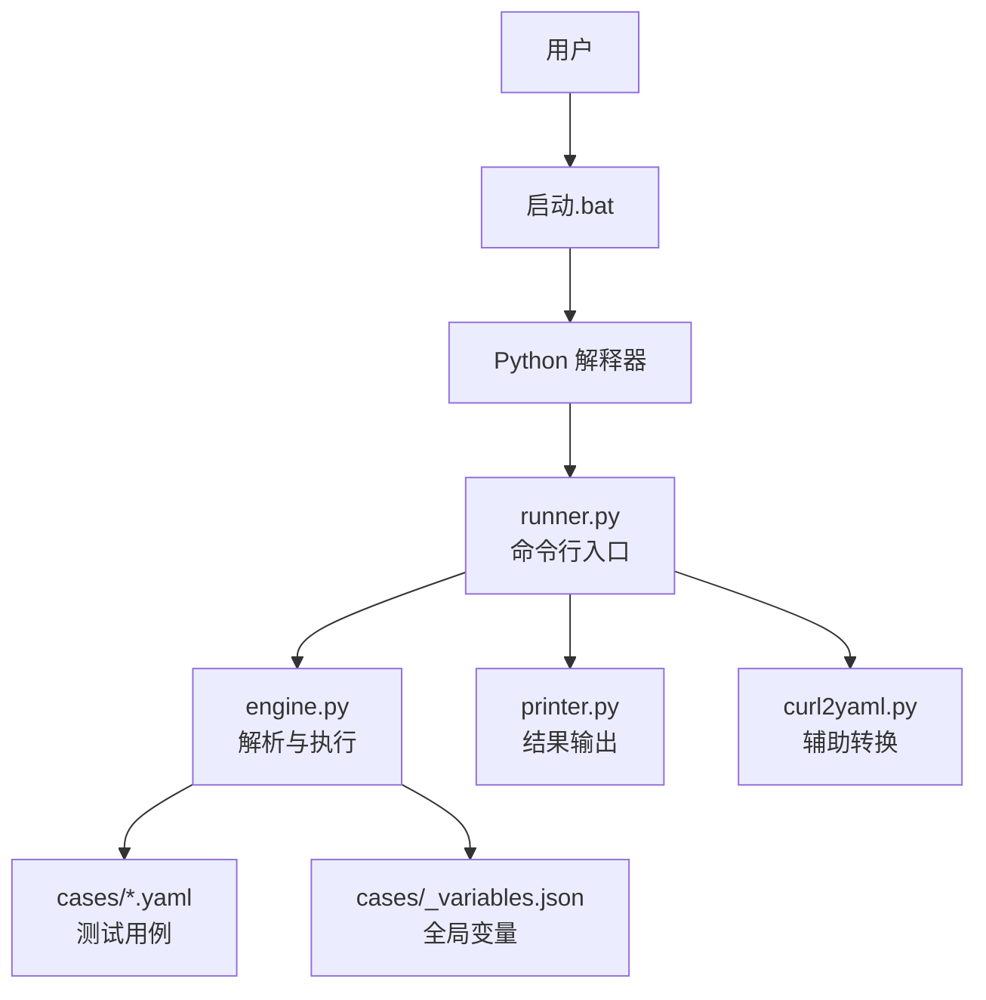
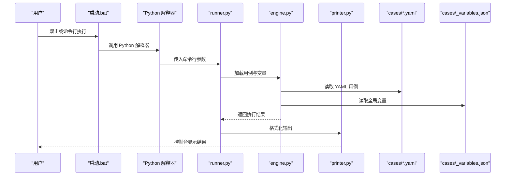
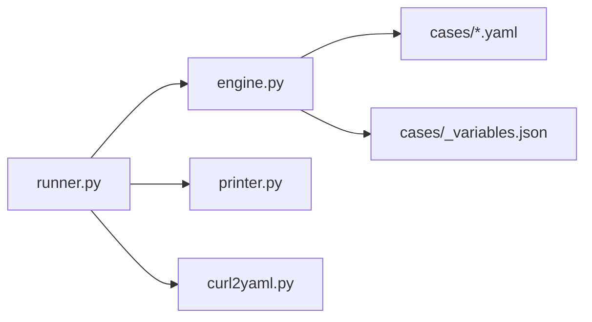

# 快速开始

<cite>
**本文引用的文件**   
- [README.md](file://README.md)
- [启动.bat](file://启动.bat)
- [engine.py](file://engine.py)
- [runner.py](file://runner.py)
- [printer.py](file://printer.py)
- [curl2yaml.py](file://curl2yaml.py)
- [cases/1.yaml](file://cases/1.yaml)
- [cases/example.yaml](file://cases/example.yaml)
- [cases/_variables.json](file://cases/_variables.json)
</cite>

## 目录
1. [简介](#简介)
2. [项目结构](#项目结构)
3. [核心组件](#核心组件)
4. [架构总览](#架构总览)
5. [详细组件分析](#详细组件分析)
6. [依赖关系分析](#依赖关系分析)
7. [性能注意事项](#性能注意事项)
8. [故障排除指南](#故障排除指南)
9. [结论](#结论)
10. [附录](#附录) 

## 简介
本指南面向首次接触 API 测试器的用户，帮助你在最短时间内完成环境准备、安装配置、编写第一个 YAML 测试用例、使用全局变量、运行测试并查看结果。文档同时提供 Windows 平台的启动脚本使用说明与常见问题排查建议，确保你能够顺利看到测试结果。

## 项目结构
仓库采用“用例 + 引擎 + 工具”的清晰分层：
- cases：存放 YAML 测试用例与全局变量
- engine.py：解析与执行测试的核心逻辑
- runner.py：命令行入口与调度器
- printer.py：结果输出与格式化打印
- curl2yaml.py：将 curl 命令转换为 YAML 用例的工具
- 启动.bat：Windows 一键启动脚本
- README.md：项目说明与用法参考

图表来源
- [启动.bat](file://启动.bat)
- [runner.py](file://runner.py)
- [engine.py](file://engine.py)
- [printer.py](file://printer.py)
- [curl2yaml.py](file://curl2yaml.py)
- [cases/1.yaml](file://cases/1.yaml)
- [cases/example.yaml](file://cases/example.yaml)
- [cases/_variables.json](file://cases/_variables.json)

章节来源
- [README.md](file://README.md)
- [启动.bat](file://启动.bat)
- [runner.py](file://runner.py)
- [engine.py](file://engine.py)
- [printer.py](file://printer.py)
- [curl2yaml.py](file://curl2yaml.py)
- [cases/1.yaml](file://cases/1.yaml)
- [cases/example.yaml](file://cases/example.yaml)
- [cases/_variables.json](file://cases/_variables.json)

## 核心组件
- 用例定义（YAML）：描述请求、断言、提取变量等测试步骤
- 全局变量（JSON）：集中管理环境相关参数，供用例引用
- 执行引擎（engine.py）：加载用例、注入变量、发起请求、执行断言、收集结果
- 运行器（runner.py）：解析命令行参数、选择用例、驱动引擎、汇总输出
- 输出器（printer.py）：以可读格式展示测试结果
- 转换工具（curl2yaml.py）：从 curl 命令生成 YAML 用例骨架，降低上手门槛
- Windows 启动脚本（启动.bat）：封装 Python 调用，简化本地运行

章节来源
- [engine.py](file://engine.py)
- [runner.py](file://runner.py)
- [printer.py](file://printer.py)
- [curl2yaml.py](file://curl2yaml.py)
- [启动.bat](file://启动.bat)

## 架构总览
下图展示了从“双击启动”到“输出结果”的端到端流程，以及各模块之间的职责边界与数据流向。

图表来源
- [启动.bat](file://启动.bat)
- [runner.py](file://runner.py)
- [engine.py](file://engine.py)
- [printer.py](file://printer.py)
- [cases/1.yaml](file://cases/1.yaml)
- [cases/example.yaml](file://cases/example.yaml)
- [cases/_variables.json](file://cases/_variables.json)

## 详细组件分析

### 环境要求与安装
- Python 版本
  - 建议使用 Python 3.8 及以上版本（推荐 3.10+），以确保兼容性与性能
- 依赖包
  - 本项目为轻量级实现，核心功能由标准库支撑；如需网络请求能力，请确保系统已安装常用第三方库（如 requests）。若未安装，可在项目根目录执行以下命令进行安装：
    - pip install requests
- 可选：虚拟环境
  - 建议在虚拟环境中运行，避免污染全局环境：
    - python -m venv .venv
    - 激活后执行 pip install requests

章节来源
- [README.md](file://README.md)

### 在 Windows 上快速启动
- 直接双击运行“启动.bat”，该脚本会调用当前目录下的 Python 解释器并执行 runner.py
- 若提示找不到 Python，请检查环境变量 PATH 是否正确指向 Python 安装路径
- 如需指定用例目录或过滤用例，可通过命令行参数传递给 runner.py（详见下一节）

章节来源
- [启动.bat](file://启动.bat)
- [runner.py](file://runner.py)

### 编写你的第一个 YAML 测试用例
- 新建一个 YAML 文件到 cases 目录，例如 cases/my_first_test.yaml
- 基本结构建议包含：
  - 名称与描述：便于识别
  - 请求信息：方法、URL、头部、查询参数、请求体等
  - 断言：对状态码、响应头、响应体字段等进行校验
  - 变量提取：从响应中提取值，供后续用例复用
- 参考已有示例：
  - cases/example.yaml
  - cases/1.yaml

章节来源
- [cases/example.yaml](file://cases/example.yaml)
- [cases/1.yaml](file://cases/1.yaml)

### 使用全局变量配置
- 全局变量文件位置：cases/_variables.json
- 用途：集中管理不同环境的公共参数（如域名、鉴权 token、超时时间等）
- 在 YAML 用例中通过占位符引用变量，运行时会被替换为实际值
- 建议按环境拆分变量文件，或在变量文件中通过键区分环境

章节来源
- [cases/_variables.json](file://cases/_variables.json)

### 运行测试与查看结果
- 方式一：双击“启动.bat”运行默认用例集
- 方式二：命令行运行
  - 进入项目根目录，执行：python runner.py
  - 可附加参数指定用例目录或过滤用例名（具体参数请参考 runner.py 的实现）
- 查看结果
  - 控制台会输出每条用例的执行摘要与失败详情
  - 如需更详细的日志，可在 runner.py 中开启调试模式（如有相应开关）

章节来源
- [启动.bat](file://启动.bat)
- [runner.py](file://runner.py)
- [printer.py](file://printer.py)

### 从 curl 快速生成 YAML 用例
- 使用 curl2yaml.py 将 curl 命令转换为 YAML 骨架，减少手工编写成本
- 典型用法：
  - 将 curl 命令粘贴到输入或管道中，运行脚本即可得到对应的 YAML 片段
  - 生成的 YAML 可直接放入 cases 目录，再补充断言与变量引用

章节来源
- [curl2yaml.py](file://curl2yaml.py)

## 依赖关系分析
- 模块耦合
  - runner.py 作为入口，负责参数解析与任务编排
  - engine.py 负责用例解析、变量注入、请求执行与断言
  - printer.py 仅负责输出格式化，低耦合
  - curl2yaml.py 独立工具，不侵入主流程
- 外部依赖
  - 网络请求可能依赖 requests 库；若未安装，请在执行前安装
- 潜在循环依赖
  - 当前结构为单向依赖，未见循环导入风险

图表来源
- [runner.py](file://runner.py)
- [engine.py](file://engine.py)
- [printer.py](file://printer.py)
- [curl2yaml.py](file://curl2yaml.py)
- [cases/1.yaml](file://cases/1.yaml)
- [cases/example.yaml](file://cases/example.yaml)
- [cases/_variables.json](file://cases/_variables.json)

章节来源
- [runner.py](file://runner.py)
- [engine.py](file://engine.py)
- [printer.py](file://printer.py)
- [curl2yaml.py](file://curl2yaml.py)

## 性能注意事项
- 并发与限流
  - 若需批量执行大量用例，建议分批运行或通过 runner 参数控制并发度（如实现支持）
- 网络优化
  - 合理设置超时与重试策略，避免阻塞
  - 复用连接（如启用 keep-alive）可减少握手开销
- 资源清理
  - 避免在测试中创建持久化资源；必要时在用例末尾添加清理步骤

[本节为通用指导，无需代码来源]

## 故障排除指南
- 无法找到 Python 或命令不存在
  - 确认已安装 Python 并将安装路径加入系统 PATH
  - 在命令行执行 python --version 验证
- 缺少依赖库（如 requests）
  - 在项目根目录执行：pip install requests
- 启动.bat 无输出或闪退
  - 打开 cmd，手动执行 python runner.py 查看错误堆栈
  - 检查 cases 目录下是否存在有效的 YAML 用例
- 用例执行失败
  - 检查 URL、方法与请求体是否匹配目标服务
  - 核对全局变量 _variables.json 中的占位符是否被正确替换
  - 查看断言条件是否符合预期
- 编码问题
  - 确保终端编码为 UTF-8，避免中文乱码
- 权限问题
  - 在需要时以管理员身份运行命令行或脚本

章节来源
- [启动.bat](file://启动.bat)
- [runner.py](file://runner.py)
- [cases/_variables.json](file://cases/_variables.json)

## 结论
通过以上步骤，你可以在 Windows 平台上快速搭建并运行 API 测试器，编写首个 YAML 用例，利用全局变量管理环境差异，并通过控制台直观查看测试结果。结合 curl2yaml.py 可将现有 curl 命令快速转化为用例，显著提升效率。

[本节为总结性内容，无需代码来源]

## 附录
- 常用命令速查
  - 双击“启动.bat”运行默认用例
  - 命令行运行：python runner.py
  - 安装依赖：pip install requests
- 参考文件
  - 用例示例：cases/example.yaml、cases/1.yaml
  - 全局变量：cases/_variables.json
  - 转换工具：curl2yaml.py

章节来源
- [启动.bat](file://启动.bat)
- [runner.py](file://runner.py)
- [curl2yaml.py](file://curl2yaml.py)
- [cases/example.yaml](file://cases/example.yaml)
- [cases/1.yaml](file://cases/1.yaml)
- [cases/_variables.json](file://cases/_variables.json)