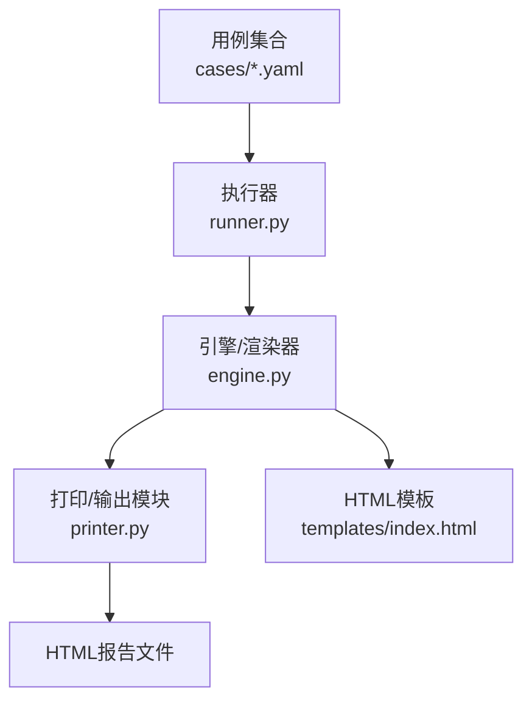
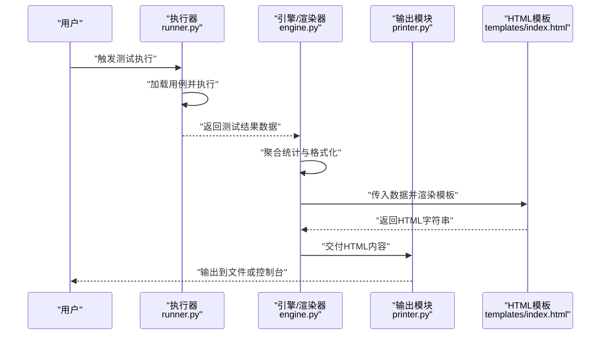
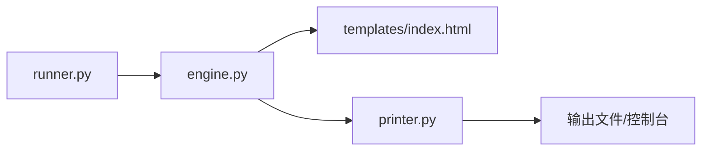

# 报告生成功能

<cite>
**本文引用的文件**   
- [README.md](file://README.md)
- [templates/index.html](file://templates/index.html)
- [engine.py](file://engine.py)
- [runner.py](file://runner.py)
- [printer.py](file://printer.py)
</cite>

## 目录
1. [简介](#简介)
2. [项目结构](#项目结构)
3. [核心组件](#核心组件)
4. [架构总览](#架构总览)
5. [详细组件分析](#详细组件分析)
6. [依赖关系分析](#依赖关系分析)
7. [性能考虑](#性能考虑)
8. [故障排查指南](#故障排查指南)
9. [结论](#结论)
10. [附录](#附录)

## 简介
本章节概述报告生成功能的总体目标与使用场景。该功能用于将自动化测试的执行结果渲染为HTML报告，便于查看、分享与归档。报告模板位于模板目录中，可通过修改模板来自定义样式与布局；测试结果数据由执行引擎生成并传递给模板进行渲染。

## 项目结构
与报告生成相关的关键位置如下：
- 模板文件：templates/index.html
- 执行与渲染逻辑：engine.py、runner.py、printer.py
- 使用说明与背景：README.md

图表来源
- [engine.py](file://engine.py)
- [runner.py](file://runner.py)
- [printer.py](file://printer.py)
- [templates/index.html](file://templates/index.html)

章节来源
- [README.md](file://README.md)
- [templates/index.html](file://templates/index.html)
- [engine.py](file://engine.py)
- [runner.py](file://runner.py)
- [printer.py](file://printer.py)

## 核心组件
- HTML模板（templates/index.html）
  - 负责报告的视觉呈现与交互逻辑，包括标题、统计概览、用例列表、详情展开等。
  - 通过读取传入的测试结果数据结构来动态渲染内容。
- 执行与渲染（engine.py、runner.py）
  - runner.py负责加载用例、驱动执行、收集结果。
  - engine.py负责汇总结果、计算统计信息、调用模板渲染生成HTML。
- 输出与导出（printer.py）
  - 负责将渲染后的HTML写入文件或控制台，支持不同输出目标与编码设置。

章节来源
- [templates/index.html](file://templates/index.html)
- [engine.py](file://engine.py)
- [runner.py](file://runner.py)
- [printer.py](file://printer.py)

## 架构总览
报告生成的端到端流程如下：

图表来源
- [runner.py](file://runner.py)
- [engine.py](file://engine.py)
- [printer.py](file://printer.py)
- [templates/index.html](file://templates/index.html)

## 详细组件分析

### HTML模板结构与定制方法（templates/index.html）
- 模板职责
  - 展示报告头部（标题、时间戳、版本信息等）。
  - 展示统计概览（总数、通过数、失败数、跳过数、耗时等）。
  - 展示用例列表与详情（名称、状态、耗时、错误信息、请求/响应摘要等）。
  - 提供交互能力（筛选、搜索、折叠/展开、跳转等）。
- 定制要点
  - 样式定制：在模板内引入或编写CSS以调整颜色、字体、间距、表格布局等。
  - 布局定制：调整DOM结构、区块顺序、分页策略、侧边栏/顶部导航等。
  - 字段定制：根据测试结果数据结构，新增/隐藏字段，或在详情面板中显示额外信息。
  - 图表定制：如需可视化，可在模板中引入图表库并在合适位置插入容器与脚本。
- 注意事项
  - 保持与数据结构的契约一致，避免字段缺失导致渲染异常。
  - 对敏感信息进行脱敏处理后再渲染。
  - 控制渲染体积，避免超大用例集导致页面卡顿。

章节来源
- [templates/index.html](file://templates/index.html)

### 测试结果数据结构与格式化
- 典型字段说明（示例性描述，具体以实际实现为准）
  - 测试状态：表示单条用例的执行结果（如通过、失败、跳过等），用于统计与着色。
  - 执行时间：记录用例从开始到结束的时间跨度，可用于排序与瓶颈定位。
  - 错误信息：当用例失败时包含的错误原因、堆栈或断言失败详情。
  - 其他常见字段：用例名称、所属分组、请求URL/方法、响应码、响应体摘要、重试次数等。
- 格式化方式
  - 文本字段：统一去除多余空白、截断过长内容、转义特殊字符。
  - 数值字段：保留合理精度、单位换算（毫秒/秒）、千分位分隔。
  - 时间字段：标准化为可读格式（如YYYY-MM-DD HH:mm:ss），并提供相对时间（如“距今X分钟”）。
  - 结构化字段：JSON/XML响应可折叠展示，支持语法高亮与复制按钮。
- 数据来源与传递
  - runner.py在执行过程中收集原始结果。
  - engine.py对结果进行清洗、聚合与统计，形成最终渲染数据。
  - 模板按约定键名访问数据并渲染。

章节来源
- [runner.py](file://runner.py)
- [engine.py](file://engine.py)
- [templates/index.html](file://templates/index.html)

### 报告定制示例（添加自定义字段、图表、统计）
- 添加自定义字段
  - 在模板中定位用例列表或详情区域，依据数据结构插入新列或新段落。
  - 确保新字段有默认值与空值处理，避免渲染崩溃。
- 添加图表
  - 在模板中引入图表库（如轻量级方案），准备容器元素。
  - 基于统计数据（通过率、失败分布、耗时趋势）构造数据集并渲染。
- 添加统计信息
  - 在引擎层扩展统计维度（如按分组统计、按环境统计）。
  - 在模板中对应位置展示新的统计卡片或指标。
- 最佳实践
  - 渐进增强：先保证基础渲染稳定，再逐步增加交互与可视化。
  - 性能优先：大数据量时使用虚拟滚动或分页加载。
  - 可维护性：将样式与脚本模块化，避免模板臃肿。

章节来源
- [templates/index.html](file://templates/index.html)
- [engine.py](file://engine.py)

### 报告导出与分享的最佳实践
- 导出格式
  - HTML：适合浏览器直接打开与分享，便于交互浏览。
  - 附加JSON：同时导出原始结果JSON，便于二次分析与自动化集成。
- 命名与归档
  - 文件名包含时间戳与环境标识，便于检索与回溯。
  - 按项目/迭代建立目录结构，定期清理历史报告。
- 分享方式
  - 本地共享：打包HTML与静态资源，通过网盘或内部站点分发。
  - 在线发布：部署静态站点服务，配置只读权限与访问控制。
- 安全与合规
  - 脱敏敏感信息（密钥、个人信息、业务机密）。
  - 限制公开范围，必要时启用访问口令或内网白名单。

章节来源
- [printer.py](file://printer.py)
- [engine.py](file://engine.py)

## 依赖关系分析
报告生成涉及的主要模块及其依赖关系如下：

图表来源
- [runner.py](file://runner.py)
- [engine.py](file://engine.py)
- [printer.py](file://printer.py)
- [templates/index.html](file://templates/index.html)

章节来源
- [runner.py](file://runner.py)
- [engine.py](file://engine.py)
- [printer.py](file://printer.py)
- [templates/index.html](file://templates/index.html)

## 性能考虑
- 模板渲染
  - 避免在模板中进行复杂计算，尽量在引擎层预处理数据。
  - 对大列表采用分页或懒加载，减少首屏渲染压力。
- 数据规模
  - 对超长响应体进行摘要与折叠，避免DOM过大。
  - 对日志与错误堆栈进行截断与分页展示。
- 资源优化
  - 合并与压缩CSS/JS，按需引入第三方库。
  - 使用CDN或本地缓存提升加载速度。

[本节为通用指导，不直接分析具体文件]

## 故障排查指南
- 常见问题
  - 模板字段缺失：检查引擎输出的数据结构是否与模板期望一致。
  - 样式错乱：确认CSS引入路径与模板DOM结构是否匹配。
  - 导出失败：检查输出路径权限与磁盘空间。
- 调试建议
  - 在引擎层打印中间结果，验证数据完整性。
  - 在模板中临时输出关键字段，定位渲染问题。
  - 使用浏览器开发者工具检查网络与控制台错误。

章节来源
- [engine.py](file://engine.py)
- [printer.py](file://printer.py)
- [templates/index.html](file://templates/index.html)

## 结论
报告生成功能将测试执行结果以HTML形式呈现，便于团队查阅与协作。通过合理定制模板与规范数据结构，可实现高度可配置的报告体验。遵循导出与分享的最佳实践，有助于提升团队协作效率与信息安全水平。

[本节为总结性内容，不直接分析具体文件]

## 附录
- 术语
  - 用例：一次具体的测试场景。
  - 状态：用例执行结果的分类（通过、失败、跳过等）。
  - 统计：对用例集合的汇总指标（总数、通过率、平均耗时等）。
- 参考
  - README.md中的使用说明与背景信息。

章节来源
- [README.md](file://README.md)