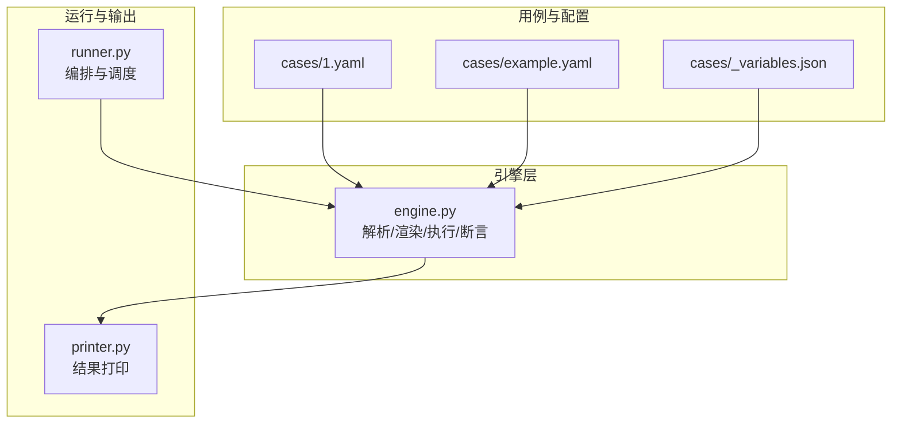
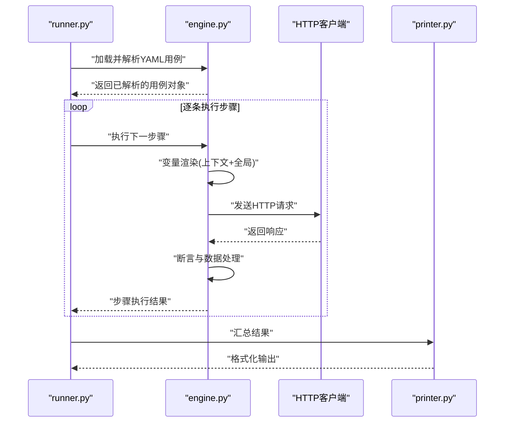
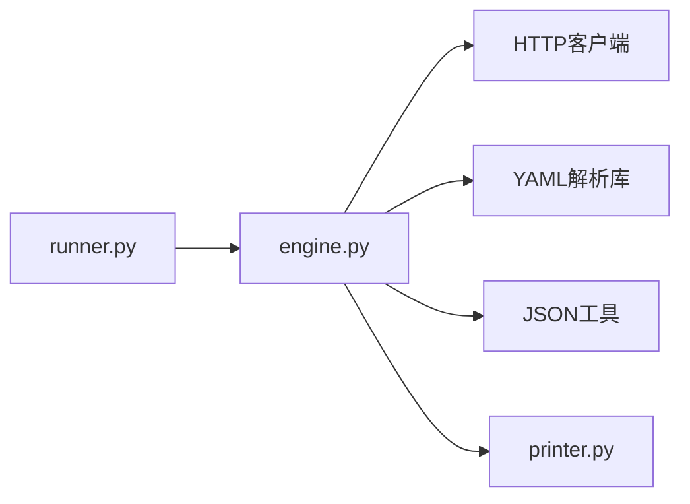

# 引擎模块(engine.py)

<cite>
**本文引用的文件**   
- [engine.py](file://engine.py)
- [runner.py](file://runner.py)
- [printer.py](file://printer.py)
- [1.yaml](file://cases/1.yaml)
- [example.yaml](file://cases/example.yaml)
- [_variables.json](file://cases/_variables.json)
</cite>

## 目录
1. [简介](#简介)
2. [项目结构](#项目结构)
3. [核心组件](#核心组件)
4. [架构总览](#架构总览)
5. [详细组件分析](#详细组件分析)
6. [依赖关系分析](#依赖关系分析)
7. [性能考虑](#性能考虑)
8. [故障排查指南](#故障排查指南)
9. [结论](#结论)
10. [附录](#附录)

## 简介
本文件为 engine.py 模块的详细技术文档，聚焦于测试引擎的实现原理与使用方式。内容涵盖：
- YAML 用例文件的加载与解析机制
- 变量替换系统的实现逻辑
- HTTP 请求的构建与发送过程
- 响应数据的验证与处理流程
- 用例执行的生命周期管理、错误处理策略与异常恢复机制
- 扩展点说明：如何添加新的验证规则或自定义处理器
- 与其他模块（如 runner.py、printer.py）的集成方式与数据传递格式

## 项目结构
仓库采用“用例 + 引擎 + 运行器 + 输出”的分层组织方式：
- cases：存放 YAML 用例与全局变量定义
- engine.py：核心测试引擎，负责解析、渲染、执行与断言
- runner.py：用例编排与调度入口
- printer.py：结果打印与格式化输出
- templates：前端模板（与本引擎无直接耦合）

图表来源
- [engine.py](file://engine.py)
- [runner.py](file://runner.py)
- [printer.py](file://printer.py)
- [1.yaml](file://cases/1.yaml)
- [example.yaml](file://cases/example.yaml)
- [_variables.json](file://cases/_variables.json)

章节来源
- [engine.py](file://engine.py)
- [runner.py](file://runner.py)
- [printer.py](file://printer.py)
- [1.yaml](file://cases/1.yaml)
- [example.yaml](file://cases/example.yaml)
- [_variables.json](file://cases/_variables.json)

## 核心组件
本节从功能维度拆解 engine.py 的核心职责与关键能力：
- 用例加载与解析：读取 YAML 用例，校验结构，生成可执行步骤
- 变量系统：支持全局变量、上下文变量、函数式变量与嵌套引用
- 请求构建：基于渲染后的参数组装 HTTP 请求（方法、URL、头、体等）
- 请求发送：调用网络库发起请求并获取响应
- 响应验证：对状态码、头部、JSON 字段等进行断言
- 生命周期管理：初始化、前置/后置钩子、清理与资源释放
- 错误处理与恢复：捕获异常、记录诊断信息、可选重试与回退
- 扩展点：注册新验证器、自定义处理器、变量函数

章节来源
- [engine.py](file://engine.py)

## 架构总览
引擎在整体系统中的位置与交互如下：
- runner.py 作为编排器，按顺序或并发调度用例
- engine.py 负责单条用例的完整生命周期：解析 -> 渲染 -> 执行 -> 断言 -> 产出结果
- printer.py 消费 engine 产出的结构化结果进行展示

图表来源
- [engine.py](file://engine.py)
- [runner.py](file://runner.py)
- [printer.py](file://printer.py)

## 详细组件分析

### YAML 用例加载与解析
- 输入来源：cases/*.yaml；支持多文件批量加载
- 解析流程：
  - 读取 YAML 文本并反序列化为 Python 对象
  - 校验必填字段（如请求方法、URL、断言列表等）
  - 将字符串形式的占位符标记为待渲染节点
- 数据结构约定：
  - 顶层为用例集合或单个用例
  - 每个步骤包含请求描述与断言清单
  - 支持步骤间变量传递（通过上下文键名）

章节来源
- [engine.py](file://engine.py)
- [1.yaml](file://cases/1.yaml)
- [example.yaml](file://cases/example.yaml)

### 变量替换系统
- 变量来源：
  - 全局变量：来自 _variables.json 或命令行注入
  - 上下文变量：由前序步骤写入，供后续步骤读取
  - 内置函数：时间戳、随机数、哈希等
- 替换策略：
  - 深度遍历渲染目标（字符串、字典、列表）
  - 支持链式引用与条件渲染
  - 未解析占位符时抛出明确错误，便于定位
- 安全与幂等：
  - 禁止执行任意表达式，仅允许白名单函数
  - 多次渲染保持结果一致

章节来源
- [engine.py](file://engine.py)
- [_variables.json](file://cases/_variables.json)

### HTTP 请求构建与发送
- 构建阶段：
  - 合并基础 URL、路径与查询参数
  - 填充请求头（含鉴权、追踪信息等）
  - 序列化请求体（JSON/表单/二进制）
- 发送阶段：
  - 设置超时、重试次数、连接池参数
  - 统一封装异常类型，附带诊断信息
- 响应处理：
  - 标准化响应对象（状态码、头部、主体、耗时）
  - 自动解码 JSON 并缓存原始字节用于调试

章节来源
- [engine.py](file://engine.py)

### 响应验证与处理流程
- 断言类型：
  - 状态码断言
  - 头部存在性与值匹配
  - JSON 路径取值与比较（等于、包含、正则、长度等）
- 处理流程：
  - 依次执行断言，收集失败原因
  - 将断言结果写入步骤上下文，供后续步骤使用
  - 支持跳过部分断言（如环境差异导致的非关键项）

章节来源
- [engine.py](file://engine.py)

### 用例执行生命周期管理
- 阶段划分：
  - 初始化：加载配置、准备变量、建立连接池
  - 前置钩子：登录、创建资源、预热数据
  - 执行：按步骤顺序执行请求与断言
  - 后置钩子：清理资源、上报指标
  - 清理：关闭连接、释放内存
- 并发控制：
  - 支持串行与有限并发执行
  - 共享上下文需加锁保护

章节来源
- [engine.py](file://engine.py)
- [runner.py](file://runner.py)

### 错误处理与异常恢复
- 异常分类：
  - 配置错误（YAML 结构缺失、变量未定义）
  - 网络错误（超时、DNS、连接拒绝）
  - 业务错误（断言失败、响应不合法）
- 恢复策略：
  - 可配置的重试与退避
  - 失败隔离：单步失败不影响其他独立步骤
  - 诊断信息：堆栈、请求快照、响应摘要

章节来源
- [engine.py](file://engine.py)

### 扩展点与自定义开发
- 新增验证规则：
  - 注册自定义断言处理器，提供名称与校验函数
  - 在 YAML 中通过名称引用新断言
- 自定义处理器：
  - 实现请求预处理/后处理钩子
  - 接入第三方 SDK（如日志、监控、A/B 开关）
- 变量函数：
  - 向变量渲染器注册新函数，暴露给用例使用

章节来源
- [engine.py](file://engine.py)

## 依赖关系分析
- 内部依赖：
  - runner.py 依赖 engine.py 提供的执行接口
  - printer.py 消费 engine.py 的结构化结果
- 外部依赖：
  - YAML 解析库
  - HTTP 客户端库
  - JSON 编解码与路径提取工具

图表来源
- [engine.py](file://engine.py)
- [runner.py](file://runner.py)
- [printer.py](file://printer.py)

章节来源
- [engine.py](file://engine.py)
- [runner.py](file://runner.py)
- [printer.py](file://printer.py)

## 性能考虑
- 连接复用：启用持久连接与连接池，减少握手开销
- 并发执行：合理限制并发度，避免压垮服务端
- 变量渲染优化：缓存已解析的常量表达式，避免重复计算
- 大响应体处理：按需流式读取与分块断言，降低内存峰值
- 超时与重试：根据服务 SLA 配置合理的超时与退避策略

[本节为通用指导，无需代码来源]

## 故障排查指南
- 常见问题定位：
  - YAML 语法错误：检查缩进与必填字段
  - 变量未解析：确认变量来源与作用域
  - 断言失败：查看断言明细与响应快照
  - 网络异常：检查超时、代理与证书配置
- 诊断信息：
  - 开启详细日志，记录请求与响应摘要
  - 导出失败用例的上下文快照，便于复现

章节来源
- [engine.py](file://engine.py)

## 结论
engine.py 作为测试引擎的核心，提供了从用例解析到请求执行与断言的全链路能力。其模块化设计与清晰的扩展点使得新增验证规则、自定义处理器与变量函数变得简单直观。配合 runner.py 的编排与 printer.py 的输出，形成完整的端到端测试闭环。

[本节为总结性内容，无需代码来源]

## 附录

### 与 runner.py 的集成方式
- 调用约定：
  - runner.py 负责加载用例集合并调用 engine 的执行接口
  - engine 返回标准化的执行结果，包含步骤级与用例级统计
- 数据格式：
  - 输入：YAML 用例对象
  - 输出：结构化结果（状态、耗时、断言明细、上下文快照）

章节来源
- [runner.py](file://runner.py)
- [engine.py](file://engine.py)

### 与 printer.py 的集成方式
- 消费格式：
  - 接收 engine 输出的结构化结果
  - 生成人类可读的报告（控制台/HTML/JSON）
- 扩展建议：
  - 增加覆盖率、趋势图、失败用例回放链接

章节来源
- [printer.py](file://printer.py)
- [engine.py](file://engine.py)

### 用例与变量示例参考
- 用例样例：
  - [1.yaml](file://cases/1.yaml)
  - [example.yaml](file://cases/example.yaml)
- 全局变量：
  - [_variables.json](file://cases/_variables.json)

章节来源
- [1.yaml](file://cases/1.yaml)
- [example.yaml](file://cases/example.yaml)
- [_variables.json](file://cases/_variables.json)