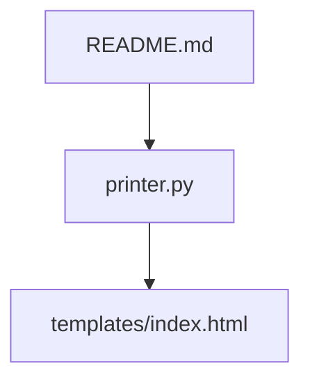
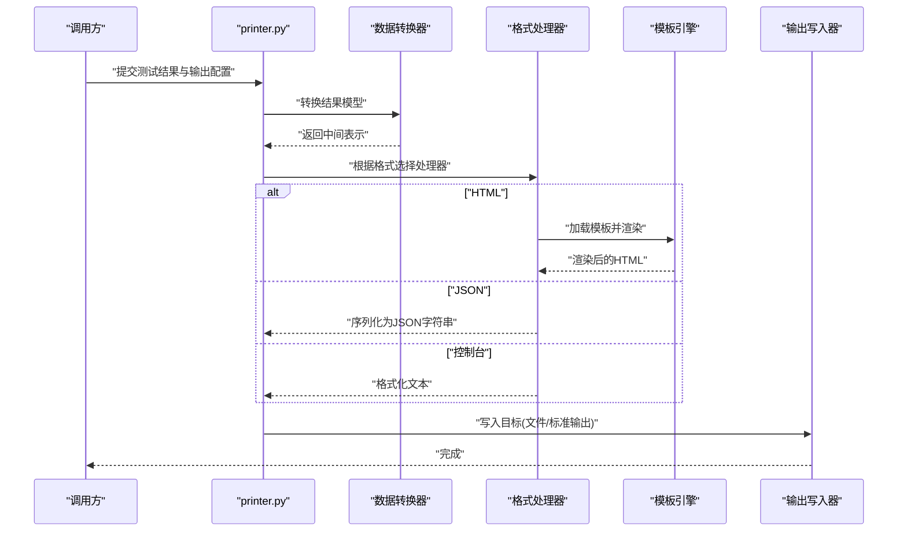
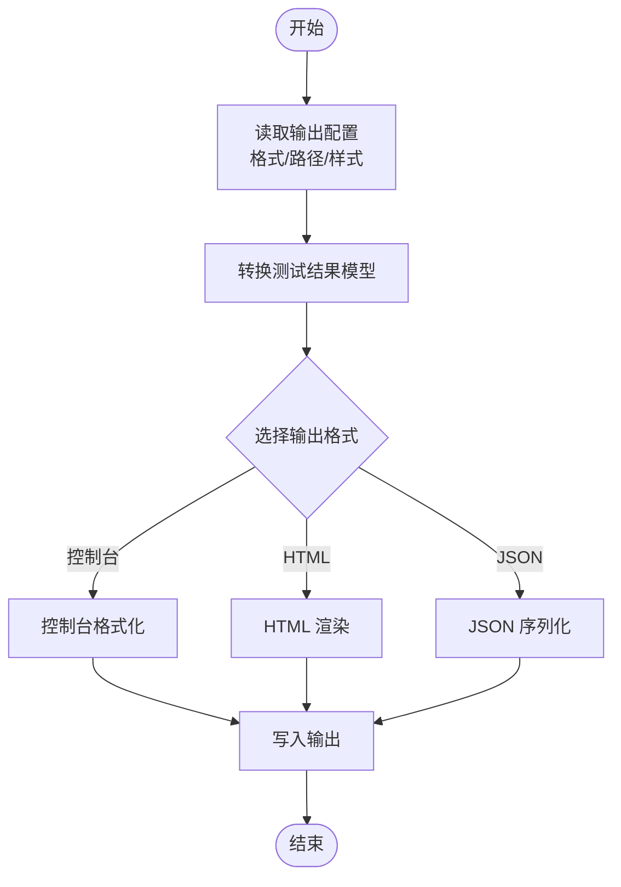
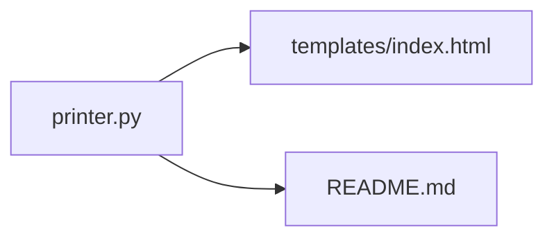

# 打印器模块(printer.py)

<cite>
**本文引用的文件**   
- [printer.py](file://printer.py)
- [templates/index.html](file://templates/index.html)
- [README.md](file://README.md)
</cite>

## 目录
1. [简介](#简介)
2. [项目结构](#项目结构)
3. [核心组件](#核心组件)
4. [架构总览](#架构总览)
5. [详细组件分析](#详细组件分析)
6. [依赖分析](#依赖分析)
7. [性能考虑](#性能考虑)
8. [故障排查指南](#故障排查指南)
9. [结论](#结论)
10. [附录](#附录)

## 简介
本技术文档聚焦于测试报告输出模块 printer.py，系统性阐述其测试结果格式化与渲染机制。内容覆盖：
- 多格式输出支持（控制台、HTML、JSON）
- 模板渲染系统与样式定制
- 测试结果数据结构转换与格式化规则
- 报告生成流程与扩展方法
- 使用示例与配置建议
- 性能优化策略

## 项目结构
仓库中与打印器相关的资源包括：
- 核心实现：printer.py
- HTML 模板：templates/index.html
- 使用说明与背景：README.md

图表来源
- [printer.py](file://printer.py)
- [templates/index.html](file://templates/index.html)
- [README.md](file://README.md)

章节来源
- [printer.py](file://printer.py)
- [templates/index.html](file://templates/index.html)
- [README.md](file://README.md)

## 核心组件
- 输出格式注册与选择器
  - 负责识别并分发到具体格式处理器（控制台、HTML、JSON）。
- 数据转换器
  - 将内部测试结果模型转换为各格式所需的中间表示。
- 模板引擎集成
  - 加载模板文件，注入上下文数据，完成渲染。
- 样式与主题配置
  - 提供可插拔的样式/主题选项，影响最终呈现效果。
- 报告写入器
  - 统一处理输出目标（标准输出、文件路径等），保证一致性与幂等性。

章节来源
- [printer.py](file://printer.py)

## 架构总览
整体流程从“原始测试结果”开始，经“数据转换”、“格式选择”、“模板渲染/序列化”，最终“写入输出”。

图表来源
- [printer.py](file://printer.py)
- [templates/index.html](file://templates/index.html)

## 详细组件分析

### 输出格式与处理器
- 控制台输出
  - 特点：轻量、可读性强，适合快速验证。
  - 适用场景：CI 日志、调试阶段。
- HTML 输出
  - 特点：富文本展示、可交互、便于归档与分享。
  - 依赖：模板文件 templates/index.html。
- JSON 输出
  - 特点：结构化、易被下游系统消费。
  - 适用场景：自动化流水线、报表聚合。

章节来源
- [printer.py](file://printer.py)
- [templates/index.html](file://templates/index.html)

### 模板渲染系统
- 模板加载
  - 通过模板路径定位模板文件，支持相对/绝对路径。
- 上下文注入
  - 将转换后的测试结果作为上下文变量注入模板。
- 渲染与缓存
  - 按需渲染；在高频调用时可启用模板缓存以减少 I/O。
- 样式定制
  - 通过模板内联或外部样式表进行主题化；推荐以配置项驱动样式切换。

章节来源
- [printer.py](file://printer.py)
- [templates/index.html](file://templates/index.html)

### 数据结构转换与格式化规则
- 输入模型
  - 典型字段包含用例标识、请求信息、响应信息、断言结果、耗时等。
- 转换策略
  - 标准化字段名、补齐缺失值、类型归一化、敏感信息脱敏。
- 格式化规则
  - 数值精度控制、时间戳本地化、布尔值可读化、错误堆栈折叠。
- 校验与容错
  - 对异常字段进行兜底处理，确保渲染不中断。

章节来源
- [printer.py](file://printer.py)

### 报告生成流程

图表来源
- [printer.py](file://printer.py)

### 自定义输出格式的扩展方法
- 新增格式步骤
  - 注册新格式名称与处理器映射。
  - 实现处理器接口：接收中间表示，返回目标文本/字节流。
  - 在格式选择器中增加分支逻辑。
- 最佳实践
  - 保持处理器无副作用；对大对象采用流式写入；避免重复计算。

章节来源
- [printer.py](file://printer.py)

### 使用示例与配置方法
- 基本用法
  - 指定输出格式为控制台/HTML/JSON，并提供必要参数（如输出路径）。
- 模板与样式
  - 通过配置项指定模板路径与样式主题；支持覆盖默认样式。
- 批量输出
  - 同一份测试结果同时输出多种格式，便于不同受众消费。

章节来源
- [printer.py](file://printer.py)
- [templates/index.html](file://templates/index.html)

## 依赖分析
- 内部依赖
  - 模板文件：templates/index.html
  - 说明文档：README.md（用于理解使用方式与约定）
- 外部依赖
  - 模板引擎：由实现决定（常见为内置模板库或第三方库）
  - 文件系统：读写输出文件
  - 标准输出：控制台模式

图表来源
- [printer.py](file://printer.py)
- [templates/index.html](file://templates/index.html)
- [README.md](file://README.md)

章节来源
- [printer.py](file://printer.py)
- [templates/index.html](file://templates/index.html)
- [README.md](file://README.md)

## 性能考虑
- 模板渲染
  - 启用模板缓存；减少重复解析开销。
- 数据转换
  - 惰性计算与增量更新；避免全量复制大对象。
- I/O 优化
  - 批量写入、缓冲输出；优先使用二进制流处理大文件。
- 内存占用
  - 对超大报告采用分块渲染/分页输出；及时释放临时对象。
- 并发安全
  - 多线程/多进程环境下确保输出写入串行化或分区隔离。

[本节为通用指导，无需特定文件引用]

## 故障排查指南
- 常见问题
  - 模板未找到：检查模板路径与权限。
  - 渲染失败：确认上下文字段完整且类型正确。
  - 输出为空：核对输出目标路径与写入权限。
- 诊断建议
  - 开启详细日志，记录关键节点耗时与异常堆栈。
  - 对异常数据进行最小复现样本，逐步定位问题。
- 恢复策略
  - 降级输出：当某格式失败时回退至控制台或 JSON。
  - 重试与熔断：针对 I/O 异常实施有限重试与快速失败。

章节来源
- [printer.py](file://printer.py)

## 结论
printer.py 提供了可扩展、可配置的测试结果输出能力，涵盖控制台、HTML、JSON 等多格式，并通过模板系统实现灵活的样式定制。遵循本文档的结构化分析与最佳实践，可在保证质量的同时提升可维护性与性能表现。

[本节为总结性内容，无需特定文件引用]

## 附录
- 术语
  - 中间表示：数据转换后、供各格式处理器消费的标准化结构。
  - 上下文：注入到模板中的变量集合。
- 参考
  - README.md 中的使用说明与约定。

章节来源
- [README.md](file://README.md)