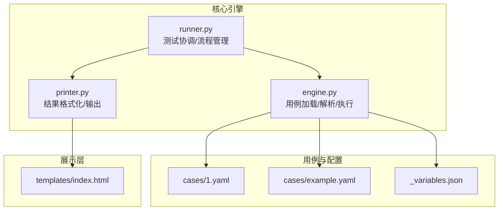
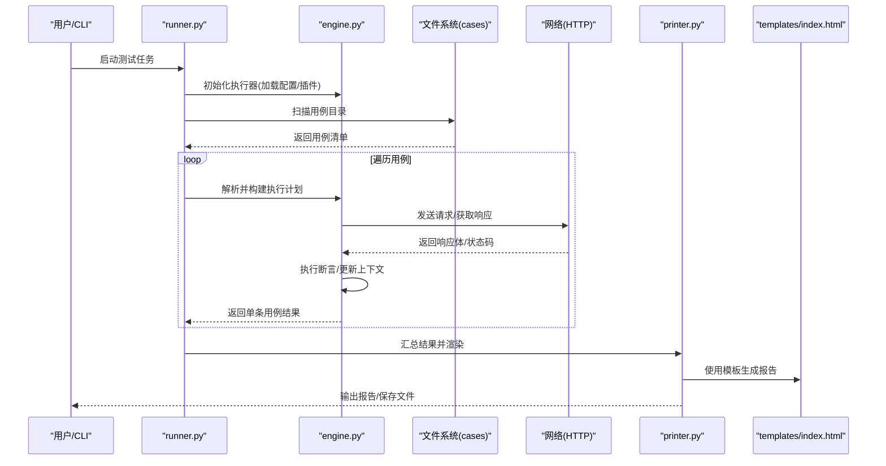
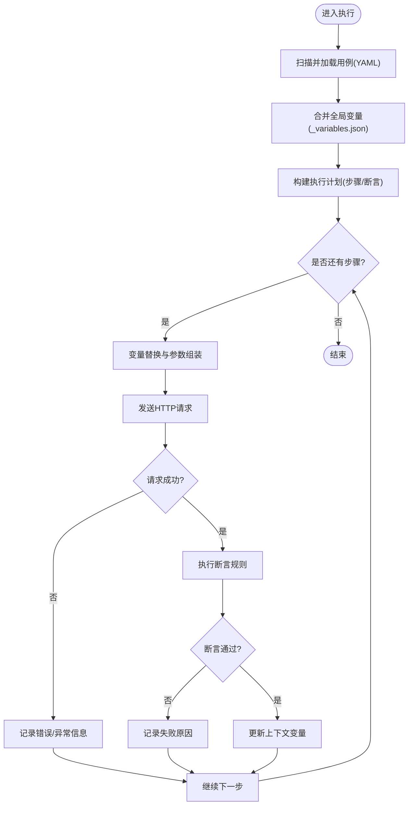
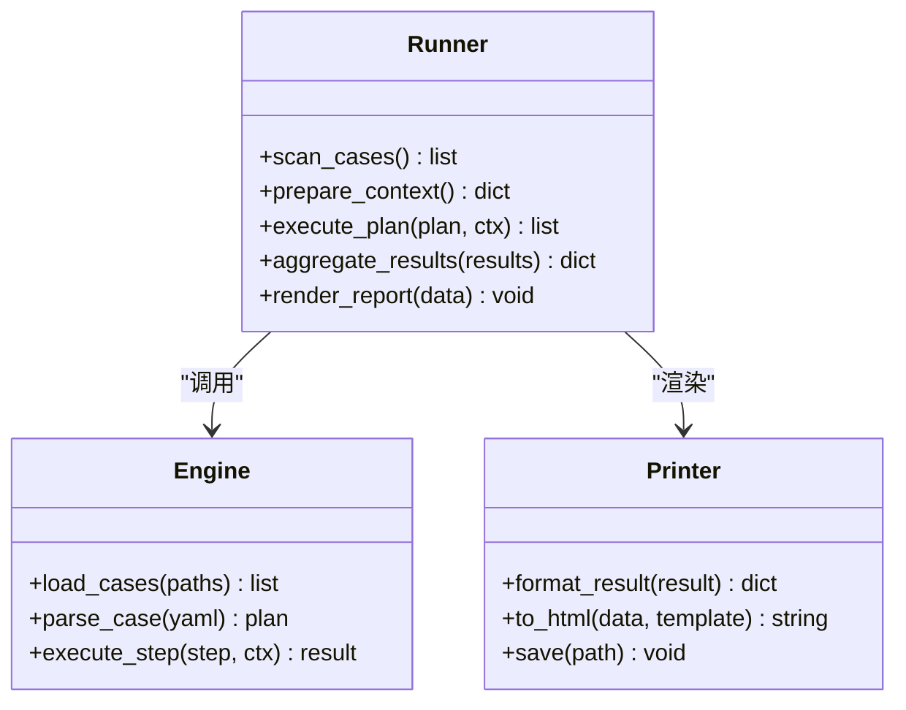
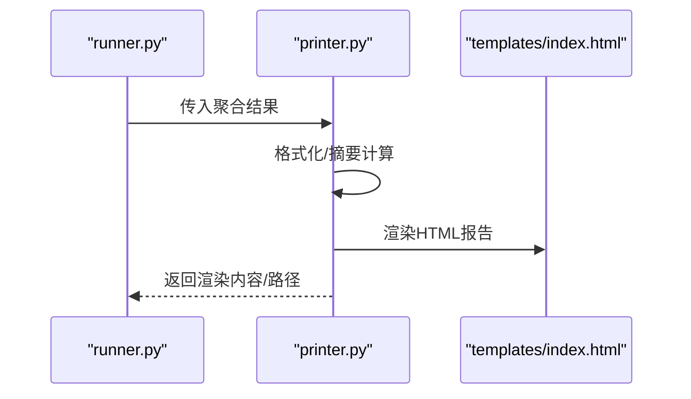
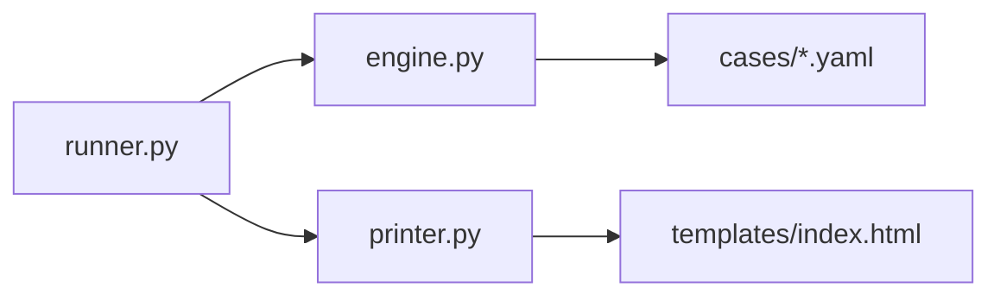

# 核心引擎详解

<cite>
**本文引用的文件**   
- [engine.py](file://engine.py)
- [runner.py](file://runner.py)
- [printer.py](file://printer.py)
- [README.md](file://README.md)
- [SKILL.md](file://SKILL.md)
- [cases/1.yaml](file://cases/1.yaml)
- [cases/example.yaml](file://cases/example.yaml)
- [templates/index.html](file://templates/index.html)
</cite>

## 目录
1. [简介](#简介)
2. [项目结构](#项目结构)
3. [核心组件](#核心组件)
4. [架构总览](#架构总览)
5. [详细组件分析](#详细组件分析)
6. [依赖关系分析](#依赖关系分析)
7. [性能考虑](#性能考虑)
8. [故障排查指南](#故障排查指南)
9. [结论](#结论)
10. [附录](#附录)

## 简介
本文件面向希望深入理解并扩展该API测试工具“核心引擎”的开发者与使用者。文档围绕用例加载、解析与执行（engine.py）、测试协调与流程管理（runner.py）、结果格式化与输出处理（printer.py）三大模块展开，系统阐述其架构设计、数据流转、错误处理、重试策略与性能优化思路，并提供扩展开发指南，帮助读者快速添加新的验证规则、自定义处理器以及集成第三方服务。

## 项目结构
仓库采用“核心引擎 + 用例 + 模板”的清晰分层：
- 核心引擎：engine.py、runner.py、printer.py
- 用例定义：cases/*.yaml（支持变量与断言等描述）
- 模板与静态资源：templates/index.html
- 说明文档：README.md、SKILL.md

图表来源
- [engine.py:1-200](file://engine.py#L1-L200)
- [runner.py:1-200](file://runner.py#L1-L200)
- [printer.py:1-200](file://printer.py#L1-L200)
- [cases/1.yaml](file://cases/1.yaml)
- [cases/example.yaml](file://cases/example.yaml)
- [templates/index.html](file://templates/index.html)

章节来源
- [README.md](file://README.md)
- [SKILL.md](file://SKILL.md)

## 核心组件
- engine.py：负责从用例目录扫描、加载与解析YAML用例，构建可执行的测试步骤，驱动请求发送与断言校验，维护上下文变量与状态。
- runner.py：作为编排器，串联用例发现、准备、执行、汇总与报告生成；管理并发、重试、超时与整体生命周期。
- printer.py：将测试结果渲染为结构化数据或HTML报告，提供多种输出格式与主题样式。

章节来源
- [engine.py:1-200](file://engine.py#L1-L200)
- [runner.py:1-200](file://runner.py#L1-L200)
- [printer.py:1-200](file://printer.py#L1-L200)

## 架构总览
整体采用“编排器-执行器-渲染器”的分层模式：
- runner.py 作为顶层编排器，负责任务调度、并发控制、重试与统计汇总。
- engine.py 作为执行器，聚焦于用例解析、变量替换、HTTP交互与断言执行。
- printer.py 作为渲染器，将执行结果转换为可读的报告或结构化数据。

图表来源
- [runner.py:1-200](file://runner.py#L1-L200)
- [engine.py:1-200](file://engine.py#L1-L200)
- [printer.py:1-200](file://printer.py#L1-L200)
- [templates/index.html](file://templates/index.html)

## 详细组件分析

### 组件一：engine.py（用例加载、解析与执行）
职责边界
- 用例发现与加载：扫描cases目录，读取YAML用例文件，合并全局变量。
- 用例解析：将YAML描述转换为内部执行模型（请求参数、断言规则、变量引用）。
- 执行驱动：按步骤发起HTTP请求，进行响应校验，更新上下文变量。
- 错误与异常：捕获网络异常、解析异常、断言失败，记录到结果对象。

关键流程
- 加载阶段：读取用例清单 -> 合并变量 -> 构建执行图。
- 执行阶段：迭代步骤 -> 变量替换 -> 发送请求 -> 断言校验 -> 收集结果。
- 清理阶段：释放连接、持久化中间态（可选）。

图表来源
- [engine.py:1-200](file://engine.py#L1-L200)
- [cases/1.yaml](file://cases/1.yaml)
- [cases/example.yaml](file://cases/example.yaml)

章节来源
- [engine.py:1-200](file://engine.py#L1-L200)
- [cases/1.yaml](file://cases/1.yaml)
- [cases/example.yaml](file://cases/example.yaml)

### 组件二：runner.py（测试协调与流程管理）
职责边界
- 任务编排：组织用例发现、准备、执行、汇总与报告输出。
- 并发与限流：控制并发度、队列与超时，避免资源耗尽。
- 重试策略：对瞬时失败进行指数退避重试，区分可重试与不可重试错误。
- 统计与上报：聚合通过率、耗时分布、失败根因，供渲染器使用。

关键流程
- 初始化：加载配置、注册插件、创建执行器与渲染器。
- 执行：按批次/并发拉取用例，调用engine执行，收集结果。
- 收尾：生成报告、持久化日志、清理资源。

图表来源
- [runner.py:1-200](file://runner.py#L1-L200)
- [engine.py:1-200](file://engine.py#L1-L200)
- [printer.py:1-200](file://printer.py#L1-L200)

章节来源
- [runner.py:1-200](file://runner.py#L1-L200)

### 组件三：printer.py（结果格式化与输出处理）
职责边界
- 结果格式化：将执行结果标准化为统一的数据结构。
- 多格式输出：支持JSON、文本、HTML等多种格式。
- 模板渲染：基于模板生成可视化报告，便于分享与归档。

关键流程
- 输入：来自runner的聚合结果。
- 转换：字段映射、摘要计算、排序过滤。
- 输出：写入文件或控制台，必要时触发回调通知。

图表来源
- [printer.py:1-200](file://printer.py#L1-L200)
- [templates/index.html](file://templates/index.html)

章节来源
- [printer.py:1-200](file://printer.py#L1-L200)
- [templates/index.html](file://templates/index.html)

## 依赖关系分析
- 模块耦合
  - runner.py 强依赖 engine.py 与 printer.py，承担编排职责。
  - engine.py 依赖文件系统（cases）与网络库（HTTP），不直接依赖渲染器。
  - printer.py 仅依赖结果数据结构与模板，保持低耦合。
- 外部依赖
  - YAML解析、HTTP客户端、模板引擎等由各自模块引入。
- 潜在循环依赖
  - 当前分层清晰，未见循环依赖迹象。

图表来源
- [runner.py:1-200](file://runner.py#L1-L200)
- [engine.py:1-200](file://engine.py#L1-L200)
- [printer.py:1-200](file://printer.py#L1-L200)
- [cases/1.yaml](file://cases/1.yaml)
- [templates/index.html](file://templates/index.html)

章节来源
- [runner.py:1-200](file://runner.py#L1-L200)
- [engine.py:1-200](file://engine.py#L1-L200)
- [printer.py:1-200](file://printer.py#L1-L200)

## 性能考虑
- 并发与限流
  - 建议以批为单位并行执行用例，限制最大并发数，避免目标服务过载。
- 连接复用
  - 复用HTTP连接池，减少握手开销。
- 变量缓存
  - 对频繁使用的变量与解析结果进行缓存，降低重复计算。
- 断言短路
  - 在关键断言失败时尽早跳过后续无关步骤，缩短执行时间。
- I/O优化
  - 批量写入报告与日志，减少磁盘I/O次数。

[本节为通用指导，无需源码引用]

## 故障排查指南
常见问题与定位要点
- 用例解析失败
  - 检查YAML语法与缩进，确认必填字段存在。
  - 参考用例样例对比差异。
- 网络异常
  - 确认目标地址可达、证书有效、代理设置正确。
  - 查看重试策略是否生效，必要时调整超时与退避参数。
- 断言失败
  - 核对断言表达式与响应结构，关注字段类型与空值情况。
- 报告未生成
  - 检查模板路径与权限，确认渲染器输出目录可写。

章节来源
- [cases/1.yaml](file://cases/1.yaml)
- [cases/example.yaml](file://cases/example.yaml)
- [templates/index.html](file://templates/index.html)

## 结论
本核心引擎以清晰的三层架构实现用例加载、执行与报告输出的解耦，具备良好的可扩展性与可维护性。通过合理的并发控制、重试策略与渲染机制，能够在保证稳定性的同时提升执行效率。遵循本文档的扩展指南，可快速新增验证规则、处理器与第三方服务集成点。

[本节为总结性内容，无需源码引用]

## 附录

### 扩展开发指南
- 添加新的验证规则
  - 在engine.py中注册新断言处理器，确保能接收响应上下文并返回布尔结果。
  - 在YAML用例中使用新规则键名，并在测试前进行单元测试覆盖。
- 自定义处理器
  - 在runner.py中扩展插件注册表，实现统一的接口契约（如before/after钩子）。
  - 在printer.py中为新处理器结果增加字段映射与展示逻辑。
- 集成第三方服务
  - 在engine.py中封装第三方SDK或HTTP调用，统一异常与重试策略。
  - 在runner.py中提供开关与配置项，便于按需启用。
- 最佳实践
  - 保持模块间低耦合，优先通过接口而非具体实现进行组合。
  - 对关键路径增加日志与指标埋点，便于问题定位与性能分析。

章节来源
- [engine.py:1-200](file://engine.py#L1-L200)
- [runner.py:1-200](file://runner.py#L1-L200)
- [printer.py:1-200](file://printer.py#L1-L200)