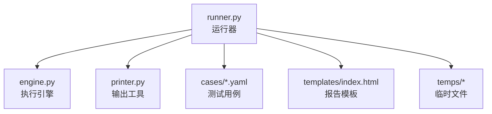
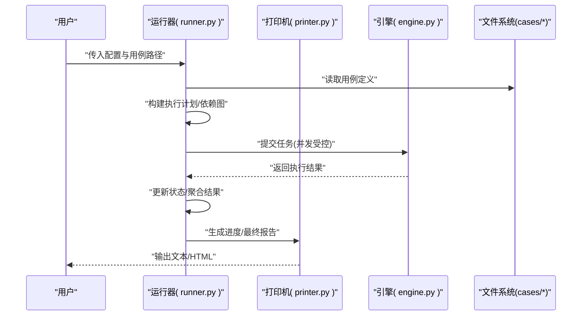
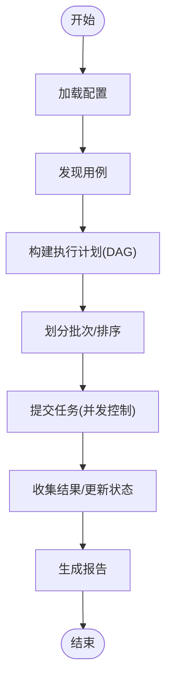
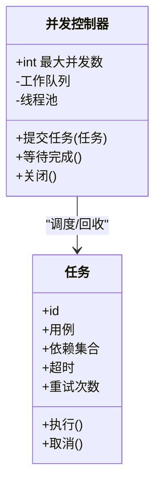
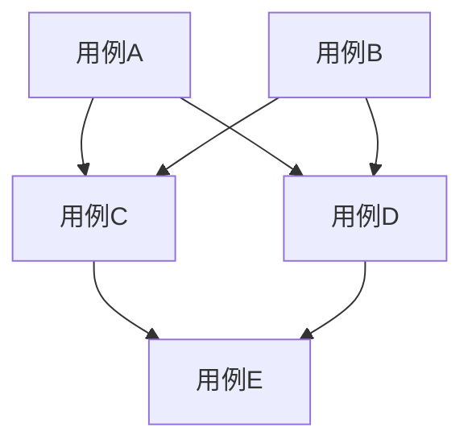
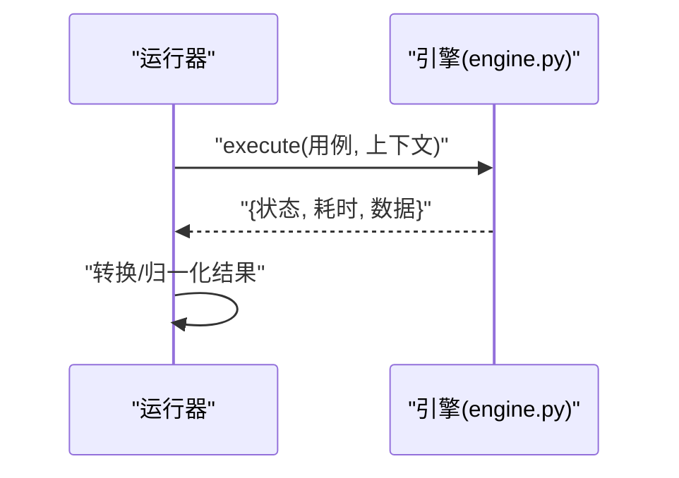
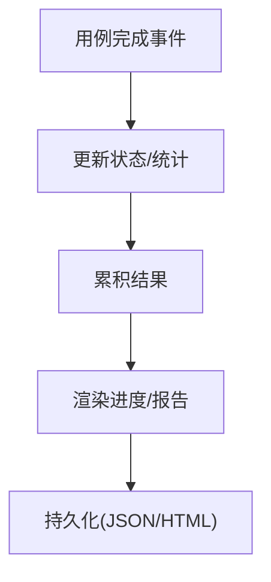
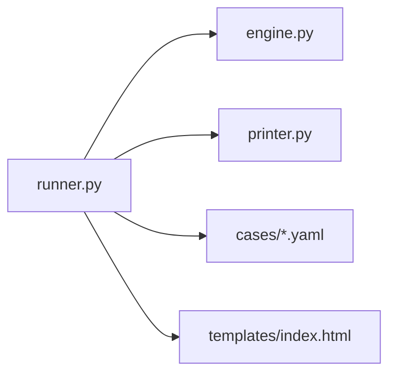

# 运行器模块(runner.py)

<cite>
**本文引用的文件**   
- [runner.py](file://runner.py)
- [engine.py](file://engine.py)
- [printer.py](file://printer.py)
- [README.md](file://README.md)
</cite>

## 目录
1. [简介](#简介)
2. [项目结构](#项目结构)
3. [核心组件](#核心组件)
4. [架构总览](#架构总览)
5. [详细组件分析](#详细组件分析)
6. [依赖关系分析](#依赖关系分析)
7. [性能考虑](#性能考虑)
8. [故障排查指南](#故障排查指南)
9. [结论](#结论)
10. [附录](#附录)

## 简介
本文件为运行器模块（runner.py）的详细技术文档，聚焦于测试运行器的协调与管理能力。内容涵盖：
- 测试套件调度与执行流程
- 并发控制机制与资源管理
- 执行状态跟踪与进度报告生成
- 用例执行顺序控制、依赖关系处理与批量执行策略
- 与引擎模块的交互接口与结果收集机制
- 配置选项说明与性能调优建议
- 实际使用场景与最佳实践指导

## 项目结构
仓库采用按功能划分的扁平结构，核心脚本位于根目录：
- runner.py：测试运行器主入口，负责加载用例、编排执行、并发控制、结果汇总与输出
- engine.py：测试执行引擎，封装底层请求/断言等执行细节
- printer.py：打印与格式化输出工具
- cases/*：YAML 格式的测试用例集
- templates/*：模板文件（如 HTML 报告模板）
- temps/*：临时文件（如中间产物）
- README.md：项目说明与使用说明

图表来源
- [runner.py](file://runner.py)
- [engine.py](file://engine.py)
- [printer.py](file://printer.py)
- [README.md](file://README.md)

章节来源
- [README.md](file://README.md)

## 核心组件
- 运行器主类/函数：负责解析配置、发现用例、构建执行计划、调度执行、收集结果、生成报告
- 并发控制器：基于线程池或进程池实现并行度限制、任务队列与生命周期管理
- 状态跟踪器：维护每个用例的执行状态（待执行、执行中、成功、失败、跳过）、统计指标与进度
- 结果聚合器：汇总各用例结果，计算通过率、耗时分布、错误分类，并持久化到文件或内存
- 引擎适配器：调用 engine.py 提供的执行接口，统一异常与返回值格式
- 输出器：通过 printer.py 将结果以文本/HTML 等形式输出

章节来源
- [runner.py](file://runner.py)
- [engine.py](file://engine.py)
- [printer.py](file://printer.py)

## 架构总览
运行器作为“编排层”，向上暴露配置与执行入口，向下对接引擎与输出工具，横向管理并发与状态。

图表来源
- [runner.py](file://runner.py)
- [engine.py](file://engine.py)
- [printer.py](file://printer.py)

## 详细组件分析

### 运行器主流程与调度
- 配置解析：从命令行参数、配置文件或环境变量加载并发度、超时、重试、过滤规则等
- 用例发现：扫描 cases 目录，解析 YAML 用例清单，提取元数据（名称、标签、依赖、优先级）
- 执行计划：根据依赖关系构建 DAG，确定可并行执行的批次；支持按标签/正则过滤
- 调度执行：将批次任务提交至并发控制器，按最大并发度分发到工作协程/线程
- 结果收集：异步回调更新状态，累计统计信息，记录错误堆栈与日志
- 报告生成：渲染进度条与最终报告，支持导出 JSON/HTML

图表来源
- [runner.py](file://runner.py)

章节来源
- [runner.py](file://runner.py)

### 并发控制与资源管理
- 并发模型：基于线程池/进程池，提供固定大小工作队列；支持动态调整并发度
- 限流与背压：当任务积压超过阈值时，触发背压策略（等待/丢弃/降级）
- 资源隔离：每个任务独立上下文（变量、会话、临时文件），避免污染
- 超时与重试：全局/单用例级超时控制；失败自动重试与退避策略
- 优雅关闭：捕获中断信号，完成已提交任务后退出，确保资源释放

图表来源
- [runner.py](file://runner.py)

章节来源
- [runner.py](file://runner.py)

### 执行顺序控制与依赖处理
- 依赖建模：用例间依赖以有向无环图表示，支持前置条件、共享变量、数据准备
- 拓扑排序：依据依赖关系进行拓扑排序，保证前置用例先执行
- 冲突消解：对循环依赖进行检测与报错；对可选依赖提供降级策略
- 批内并行：同一批次内的用例若互不依赖，则允许并行执行

图表来源
- [runner.py](file://runner.py)

章节来源
- [runner.py](file://runner.py)

### 与引擎模块的交互接口
- 统一接口：运行器通过标准接口调用 engine.py 执行单个用例（发送请求、断言、清理）
- 结果契约：约定返回结构包含状态码、消息、耗时、附加数据
- 异常映射：将引擎异常转换为运行器内部错误类型，便于统计与展示
- 钩子扩展：在执行前后注入钩子（如鉴权、埋点、日志增强）

图表来源
- [runner.py](file://runner.py)
- [engine.py](file://engine.py)

章节来源
- [runner.py](file://runner.py)
- [engine.py](file://engine.py)

### 结果收集与进度报告
- 实时进度：每完成一个用例即更新进度计数与百分比，推送至输出器
- 统计指标：总数、通过数、失败数、跳过数、平均/分位耗时、错误分布
- 持久化：将结果写入 JSON/CSV，供后续分析；HTML 报告由模板渲染
- 增量输出：长耗时场景下支持分段输出，避免一次性 IO 阻塞

图表来源
- [runner.py](file://runner.py)
- [printer.py](file://printer.py)

章节来源
- [runner.py](file://runner.py)
- [printer.py](file://printer.py)

### 配置选项说明
以下为常见配置项及其作用（具体键名以源码为准）：
- 并发相关
  - max_workers：最大并发数
  - batch_size：每批任务数量
  - queue_maxsize：任务队列上限
- 执行策略
  - timeout：全局超时
  - retry_count：默认重试次数
  - retry_backoff：重试退避策略
- 过滤与选择
  - tags：按标签筛选
  - include/exclude：包含/排除规则
  - order_by：排序策略（依赖优先/随机/自定义）
- 输出与报告
  - output_dir：输出目录
  - report_format：报告格式（text/json/html）
  - progress_interval：进度刷新间隔
- 资源与环境
  - temp_dir：临时目录
  - log_level：日志级别
  - env_file：环境变量文件路径

章节来源
- [runner.py](file://runner.py)

### 使用示例与最佳实践
- 基本用法
  - 指定用例目录与并发度，直接运行
  - 仅执行带特定标签的用例
- 高级用法
  - 结合过滤器与排序策略，构造回归/冒烟测试集
  - 设置超时与重试，提升稳定性
  - 启用 HTML 报告，便于归档与分享
- 最佳实践
  - 合理设置并发度，避免目标服务过载
  - 将易变用例拆分批次，降低耦合
  - 使用标签组织用例，按需组合执行
  - 在 CI 中开启最小化输出，减少噪音

章节来源
- [runner.py](file://runner.py)
- [README.md](file://README.md)

## 依赖关系分析
- 内部依赖
  - runner.py 依赖 engine.py 提供执行能力
  - runner.py 依赖 printer.py 进行格式化输出
  - runner.py 读取 cases/*.yaml 用例定义
  - runner.py 可能使用 templates/index.html 渲染 HTML 报告
- 外部依赖
  - 标准库：并发、IO、JSON、时间、日志等
  - 第三方库：HTTP 客户端、YAML 解析、模板引擎等（以源码导入为准）

图表来源
- [runner.py](file://runner.py)
- [engine.py](file://engine.py)
- [printer.py](file://printer.py)

章节来源
- [runner.py](file://runner.py)
- [engine.py](file://engine.py)
- [printer.py](file://printer.py)

## 性能考虑
- 并发度调优
  - 根据 CPU/IO 特性与目标服务容量设定 max_workers
  - 观察队列堆积与 GC 压力，动态调整
- 批处理策略
  - 大用例集分批执行，避免单次任务过大导致内存峰值
  - 对高延迟用例单独分组，减少尾延迟影响
- I/O 优化
  - 合并小文件写入，减少频繁磁盘 IO
  - 使用缓冲输出与异步持久化
- 缓存与复用
  - 复用连接/会话，减少握手开销
  - 对只读数据做本地缓存
- 监控与观测
  - 采集关键指标（吞吐、P95/P99 耗时、错误率）
  - 在长时间运行中定期采样，定位抖动

[本节为通用性能建议，无需代码来源]

## 故障排查指南
- 常见问题
  - 并发过高导致目标服务拒绝连接：降低并发度或增加限流
  - 用例依赖死锁：检查依赖图是否存在环，修正依赖声明
  - 超时频繁：增大超时或优化慢用例
  - 内存泄漏：检查临时文件清理与对象引用释放
- 诊断手段
  - 提高日志级别，定位失败用例与堆栈
  - 导出 JSON 结果，离线分析错误分布
  - 使用 HTML 报告查看时序与关联日志
- 恢复策略
  - 失败重试与隔离：对不稳定用例启用重试与熔断
  - 增量执行：仅重跑失败用例，缩短反馈周期

章节来源
- [runner.py](file://runner.py)
- [printer.py](file://printer.py)

## 结论
运行器模块通过清晰的编排流程、可控的并发策略、完善的依赖管理与结果收集机制，提供了稳定高效的测试执行体验。配合合理的配置与最佳实践，可在不同规模与复杂度的项目中发挥良好效果。

[本节为总结性内容，无需代码来源]

## 附录
- 术语
  - 用例：一次端到端测试的最小单元
  - 批次：一组可并行执行的用例集合
  - 依赖图：描述用例间先后关系的有向无环图
- 参考
  - README.md 中的快速上手与示例
  - engine.py 的接口契约与异常规范
  - printer.py 的输出格式与扩展方式

章节来源
- [README.md](file://README.md)
- [engine.py](file://engine.py)
- [printer.py](file://printer.py)