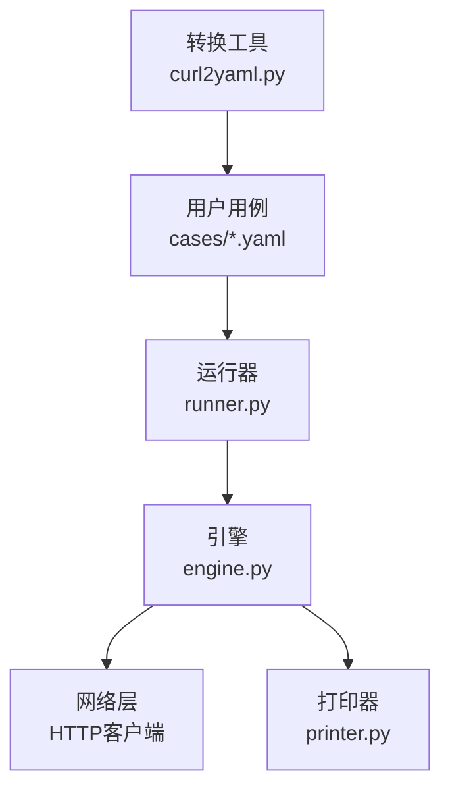
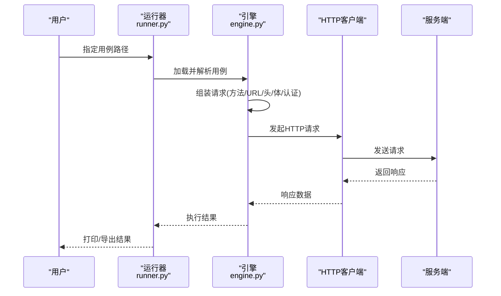
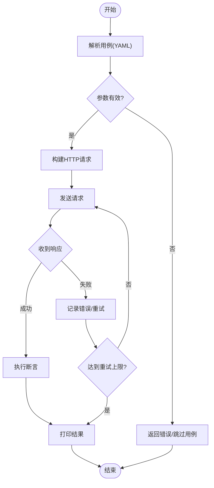
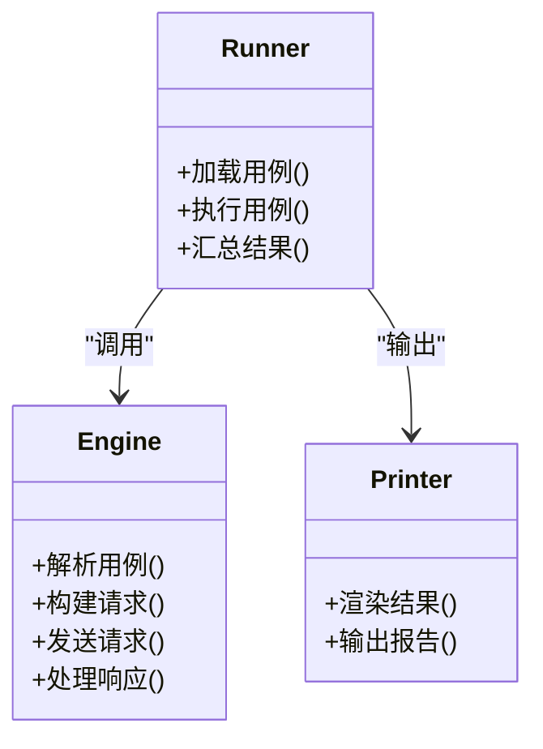
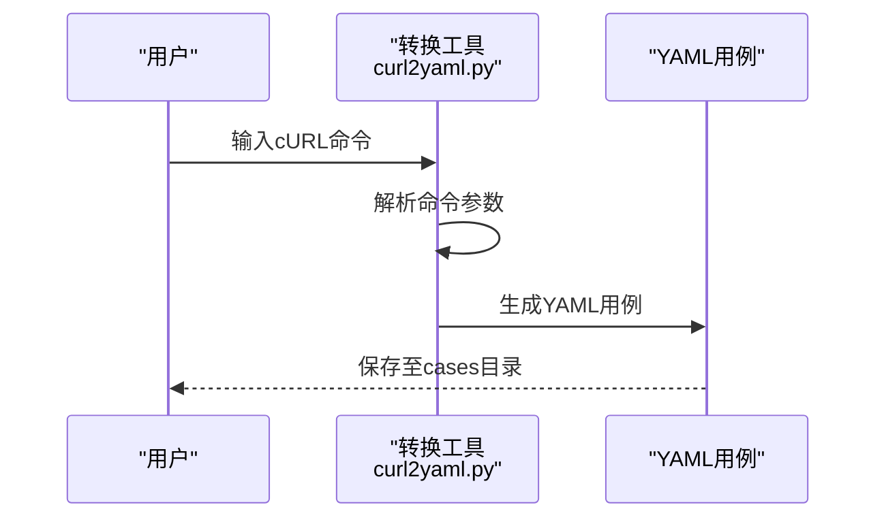
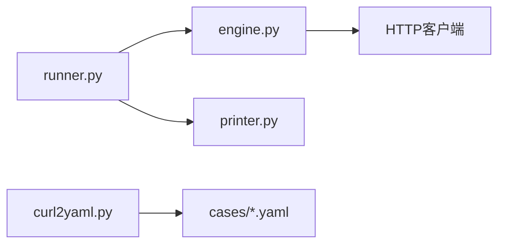

# HTTP请求配置

<cite>
**本文引用的文件**   
- [README.md](file://README.md)
- [SKILL.md](file://SKILL.md)
- [engine.py](file://engine.py)
- [runner.py](file://runner.py)
- [printer.py](file://printer.py)
- [curl2yaml.py](file://curl2yaml.py)
- [cases/example.yaml](file://cases/example.yaml)
- [cases/1.yaml](file://cases/1.yaml)
- [cases/test.yaml](file://cases/test.yaml)
- [cases/员工信息查询.yaml](file://cases/员工信息查询.yaml)
- [cases/比邻星.yaml](file://cases/比邻星.yaml)
</cite>

## 目录
1. [简介](#简介)
2. [项目结构](#项目结构)
3. [核心组件](#核心组件)
4. [架构总览](#架构总览)
5. [详细组件分析](#详细组件分析)
6. [依赖关系分析](#依赖关系分析)
7. [性能考虑](#性能考虑)
8. [故障排查指南](#故障排查指南)
9. [结论](#结论)
10. [附录](#附录)

## 简介
本文件面向使用该仓库进行HTTP接口测试的用户与开发者，系统化说明如何配置HTTP请求。内容覆盖：
- 常用HTTP方法（GET、POST、PUT、DELETE、PATCH）的配置方式
- 请求头部设置（Content-Type、Authorization、自定义头部等）
- 请求体格式支持（JSON、表单数据、文件上传等）
- 认证处理（Bearer Token、Basic Auth、API Key）
- 复杂场景示例（多部分表单提交、大文件上传、流式数据处理）

该工具通过YAML用例描述HTTP请求，由引擎解析并执行，最终输出结果。

## 项目结构
仓库采用“用例驱动”的组织方式：
- cases：存放YAML格式的测试用例，每个用例定义一个或多个HTTP请求
- engine.py：核心引擎，负责解析用例、组装请求、发送HTTP调用、收集响应
- runner.py：运行器，加载用例、调度执行、汇总结果
- printer.py：打印器，格式化输出测试结果
- curl2yaml.py：将cURL命令转换为YAML用例的辅助脚本
- README.md、SKILL.md：使用说明与技巧文档

图表来源
- [runner.py](file://runner.py)
- [engine.py](file://engine.py)
- [printer.py](file://printer.py)
- [curl2yaml.py](file://curl2yaml.py)
- [cases/example.yaml](file://cases/example.yaml)

章节来源
- [README.md](file://README.md)
- [SKILL.md](file://SKILL.md)
- [runner.py](file://runner.py)
- [engine.py](file://engine.py)
- [printer.py](file://printer.py)
- [curl2yaml.py](file://curl2yaml.py)

## 核心组件
- 用例模型（YAML）：以声明式方式描述HTTP请求，包括方法、URL、头部、请求体、认证、超时、重试等
- 引擎（engine.py）：读取用例、校验参数、构建请求、执行网络调用、处理响应与断言
- 运行器（runner.py）：管理用例集合、顺序或并发执行、统计与聚合结果
- 打印器（printer.py）：将执行结果渲染为可读文本或结构化输出
- 转换工具（curl2yaml.py）：从cURL快速生成YAML用例，降低上手门槛

章节来源
- [engine.py](file://engine.py)
- [runner.py](file://runner.py)
- [printer.py](file://printer.py)
- [curl2yaml.py](file://curl2yaml.py)

## 架构总览
整体流程：用户编写YAML用例 → 运行器加载用例 → 引擎解析并构造HTTP请求 → 发送请求并获取响应 → 打印器输出结果。

图表来源
- [runner.py](file://runner.py)
- [engine.py](file://engine.py)

## 详细组件分析

### YAML用例结构与字段
YAML用例用于声明式描述HTTP请求。常见字段包括：
- 基本信息：名称、描述、标签
- 请求定义：方法、URL、查询参数、路径参数
- 头部：Content-Type、Authorization、自定义头部
- 请求体：JSON对象、表单键值对、文件引用
- 认证：Bearer Token、Basic Auth、API Key
- 控制项：超时、重试、是否跳过、变量替换
- 断言：状态码、响应体关键字、耗时阈值等

建议将多个相关请求组织为一个用例集，便于批量执行与回归。

章节来源
- [cases/example.yaml](file://cases/example.yaml)
- [cases/1.yaml](file://cases/1.yaml)
- [cases/test.yaml](file://cases/test.yaml)
- [cases/员工信息查询.yaml](file://cases/员工信息查询.yaml)
- [cases/比邻星.yaml](file://cases/比邻星.yaml)

### HTTP方法与配置语法
- GET：常用于查询数据，参数可通过URL查询字符串或路径参数传递
- POST：创建资源，通常携带JSON或表单请求体
- PUT：全量更新资源，请求体包含完整资源数据
- DELETE：删除资源，可附带可选的请求体或仅使用路径参数标识
- PATCH：增量更新资源，请求体包含变更片段

在YAML中，通过统一字段表达方法、URL与参数，引擎会将其映射到具体HTTP语义。

章节来源
- [cases/example.yaml](file://cases/example.yaml)
- [cases/1.yaml](file://cases/1.yaml)
- [cases/test.yaml](file://cases/test.yaml)
- [cases/员工信息查询.yaml](file://cases/员工信息查询.yaml)
- [cases/比邻星.yaml](file://cases/比邻星.yaml)

### 请求头部设置
- Content-Type：根据请求体类型自动或手动设置，如application/json、multipart/form-data、application/x-www-form-urlencoded
- Authorization：支持Bearer Token、Basic Auth等模式
- 自定义头部：按需添加业务所需头部，如X-Correlation-Id、X-Request-Source等

注意：当请求体为文件或多部分表单时，Content-Type应由引擎根据边界自动生成，避免手动设置导致服务端解析失败。

章节来源
- [cases/example.yaml](file://cases/example.yaml)
- [cases/1.yaml](file://cases/1.yaml)
- [cases/test.yaml](file://cases/test.yaml)
- [cases/员工信息查询.yaml](file://cases/员工信息查询.yaml)
- [cases/比邻星.yaml](file://cases/比邻星.yaml)

### 请求体格式支持
- JSON：适用于结构化数据，需确保Content-Type为application/json
- 表单数据：application/x-www-form-urlencoded，适合简单键值对
- 多部分表单（multipart/form-data）：适合文件上传与混合数据
- 纯文本/二进制：按字节流发送，适用于特定协议或中间件

对于大文件或流式数据，建议使用分块上传或流式写入以减少内存占用。

章节来源
- [cases/example.yaml](file://cases/example.yaml)
- [cases/1.yaml](file://cases/1.yaml)
- [cases/test.yaml](file://cases/test.yaml)
- [cases/员工信息查询.yaml](file://cases/员工信息查询.yaml)
- [cases/比邻星.yaml](file://cases/比邻星.yaml)

### 认证处理配置
- Bearer Token：在Authorization头部携带令牌，适用于OAuth2/JWT等
- Basic Auth：用户名与密码经Base64编码后放入Authorization头部
- API Key：通过查询参数、请求头或Cookie注入，依服务端约定而定

建议在环境变量或集中配置中管理敏感信息，避免硬编码。

章节来源
- [cases/example.yaml](file://cases/example.yaml)
- [cases/1.yaml](file://cases/1.yaml)
- [cases/test.yaml](file://cases/test.yaml)
- [cases/员工信息查询.yaml](file://cases/员工信息查询.yaml)
- [cases/比邻星.yaml](file://cases/比邻星.yaml)

### 复杂请求场景示例
- 多部分表单提交：同时提交表单字段与多个文件，Content-Type由引擎自动设置
- 大文件上传：采用分块或流式传输，配合超时与重试策略提升稳定性
- 流式数据处理：服务端返回流式响应时，客户端应逐块消费并记录进度

章节来源
- [cases/example.yaml](file://cases/example.yaml)
- [cases/1.yaml](file://cases/1.yaml)
- [cases/test.yaml](file://cases/test.yaml)
- [cases/员工信息查询.yaml](file://cases/员工信息查询.yaml)
- [cases/比邻星.yaml](file://cases/比邻星.yaml)

### 引擎执行流程（代码级）
引擎负责将YAML用例转化为实际HTTP请求，关键步骤如下：
- 解析用例：读取YAML，校验必填字段，合并默认值
- 构建请求：组合方法、URL、头部、请求体、认证信息
- 发送请求：调用底层HTTP客户端，处理连接、超时、重试
- 处理响应：解析状态码、响应体、头部，执行断言
- 输出结果：交由打印器渲染

图表来源
- [engine.py](file://engine.py)
- [runner.py](file://runner.py)
- [printer.py](file://printer.py)

章节来源
- [engine.py](file://engine.py)
- [runner.py](file://runner.py)
- [printer.py](file://printer.py)

### 运行器与打印器协作
- 运行器：加载用例集，按顺序或并发执行，汇总统计信息（通过/失败/跳过）
- 打印器：将执行结果渲染为人类可读格式，便于定位问题

图表来源
- [runner.py](file://runner.py)
- [engine.py](file://engine.py)
- [printer.py](file://printer.py)

章节来源
- [runner.py](file://runner.py)
- [printer.py](file://printer.py)

### cURL转YAML工具
提供从cURL命令快速生成YAML用例的能力，帮助迁移现有测试或快速验证接口。

图表来源
- [curl2yaml.py](file://curl2yaml.py)

章节来源
- [curl2yaml.py](file://curl2yaml.py)

## 依赖关系分析
- 运行器依赖引擎与打印器
- 引擎依赖网络库（HTTP客户端）与YAML解析库
- 转换工具独立于运行期，仅在准备阶段使用

图表来源
- [runner.py](file://runner.py)
- [engine.py](file://engine.py)
- [printer.py](file://printer.py)
- [curl2yaml.py](file://curl2yaml.py)

章节来源
- [runner.py](file://runner.py)
- [engine.py](file://engine.py)
- [printer.py](file://printer.py)
- [curl2yaml.py](file://curl2yaml.py)

## 性能考虑
- 并发执行：合理设置并发度，避免压垮被测服务
- 超时与重试：为大请求设置更长超时，结合指数退避重试
- 流式处理：对大文件上传/下载启用流式读写，减少内存峰值
- 缓存与复用：复用连接与会话，减少握手开销
- 断言优化：仅断言必要字段，避免过度比较导致性能下降

[本节为通用指导，不直接分析具体文件]

## 故障排查指南
- 认证失败：检查Authorization头部格式与令牌有效性；确认Basic Auth凭据正确
- 415不支持媒体类型：核对Content-Type与请求体格式匹配
- 400/422参数错误：检查URL参数、路径参数与请求体结构
- 5xx服务端错误：查看服务端日志，确认上游依赖可用性
- 超时：增大超时时间或优化请求体大小；必要时启用分块上传
- 文件上传失败：确认multipart表单字段名与边界正确；检查文件大小限制

章节来源
- [cases/example.yaml](file://cases/example.yaml)
- [cases/1.yaml](file://cases/1.yaml)
- [cases/test.yaml](file://cases/test.yaml)
- [cases/员工信息查询.yaml](file://cases/员工信息查询.yaml)
- [cases/比邻星.yaml](file://cases/比邻星.yaml)

## 结论
通过YAML用例与引擎化执行，本项目提供了简洁而强大的HTTP请求配置能力。遵循本文档的方法，可高效完成各类接口测试与集成验证，并在复杂场景中保持稳定性与可维护性。

[本节为总结，不直接分析具体文件]

## 附录
- 最佳实践
  - 将敏感信息置于环境变量或密钥管理系统
  - 为不同环境（开发/测试/生产）维护独立用例集
  - 使用断言保障契约稳定，避免漂移
  - 定期清理无用用例，保持用例集精简
- 参考用例
  - 基础请求与头部设置
  - 认证与权限控制
  - 文件上传与多部分表单
  - 复杂业务链路编排

章节来源
- [cases/example.yaml](file://cases/example.yaml)
- [cases/1.yaml](file://cases/1.yaml)
- [cases/test.yaml](file://cases/test.yaml)
- [cases/员工信息查询.yaml](file://cases/员工信息查询.yaml)
- [cases/比邻星.yaml](file://cases/比邻星.yaml)