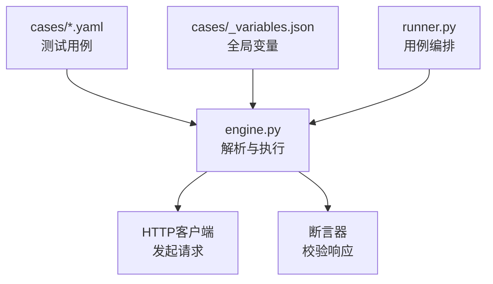
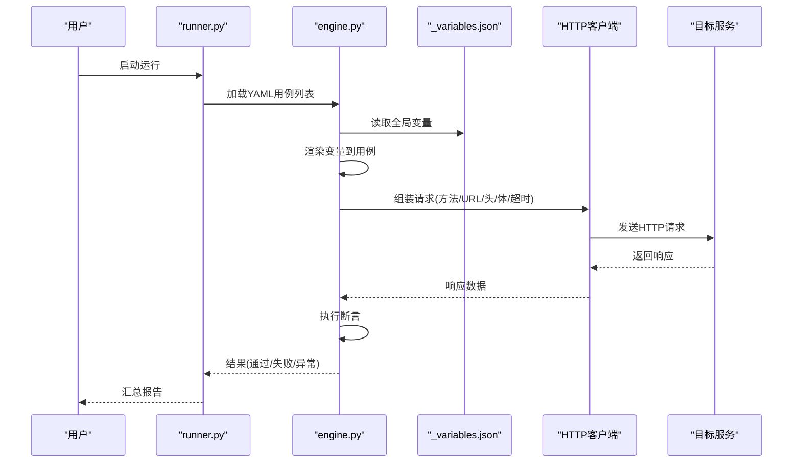
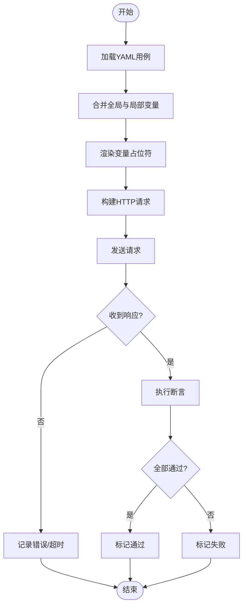
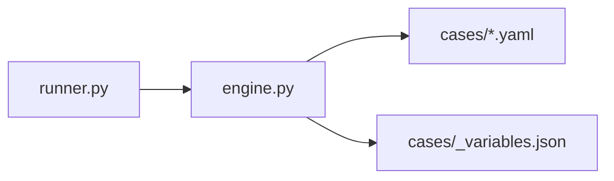

# YAML配置文件语法

<cite>
**本文引用的文件**   
- [cases/example.yaml](file://cases/example.yaml)
- [cases/1.yaml](file://cases/1.yaml)
- [cases/test.yaml](file://cases/test.yaml)
- [cases/new.yaml](file://cases/new.yaml)
- [cases/员工信息查询.yaml](file://cases/员工信息查询.yaml)
- [cases/比邻星.yaml](file://cases/比邻星.yaml)
- [cases/_variables.json](file://cases/_variables.json)
- [engine.py](file://engine.py)
- [runner.py](file://runner.py)
</cite>

## 目录
1. [简介](#简介)
2. [项目结构](#项目结构)
3. [核心组件](#核心组件)
4. [架构总览](#架构总览)
5. [详细组件分析](#详细组件分析)
6. [依赖关系分析](#依赖关系分析)
7. [性能考虑](#性能考虑)
8. [故障排查指南](#故障排查指南)
9. [结论](#结论)
10. [附录](#附录)

## 简介
本文件面向使用本仓库进行API测试的用户，系统化说明YAML测试用例配置文件的语法与最佳实践。内容覆盖：
- 请求方法（GET、POST、PUT、DELETE等）
- URL配置
- 请求头部信息设置
- 请求体数据格式
- 超时配置
- 变量与参数化
- 断言与校验
- 常见错误与调试技巧

目标是帮助读者快速编写正确、可维护的YAML测试用例，并理解其在引擎中的执行流程。

## 项目结构
仓库中与YAML用例相关的核心位置如下：
- cases：存放所有YAML用例与变量文件
- engine.py：解析YAML、组装HTTP请求、执行断言的核心逻辑
- runner.py：用例加载与运行编排

图表来源
- [engine.py](file://engine.py)
- [runner.py](file://runner.py)
- [cases/example.yaml](file://cases/example.yaml)
- [cases/_variables.json](file://cases/_variables.json)

章节来源
- [engine.py](file://engine.py)
- [runner.py](file://runner.py)
- [cases/example.yaml](file://cases/example.yaml)
- [cases/_variables.json](file://cases/_variables.json)

## 核心组件
- YAML用例定义：描述一次API调用的完整意图，包括URL、方法、头、体、超时、断言等。
- 变量系统：支持在YAML中引用变量，变量来源于全局变量文件或运行时注入。
- 执行引擎：读取YAML，渲染变量，构造HTTP请求，发送并收集响应，执行断言。
- 运行器：负责发现、加载、顺序或并发执行用例集合。

章节来源
- [engine.py](file://engine.py)
- [runner.py](file://runner.py)
- [cases/example.yaml](file://cases/example.yaml)
- [cases/_variables.json](file://cases/_variables.json)

## 架构总览
下图展示了从用例到执行的端到端流程，以及关键数据流转。

图表来源
- [engine.py](file://engine.py)
- [runner.py](file://runner.py)
- [cases/_variables.json](file://cases/_variables.json)

## 详细组件分析

### YAML用例顶层结构
一个完整的YAML用例通常包含以下字段（按功能分组）：
- 基本信息
  - name：用例名称（字符串，建议必填，便于报告识别）
  - tags：标签（数组，可选，用于筛选）
- 请求定义
  - method：HTTP方法（字符串，枚举值如GET/POST/PUT/DELETE/PATCH/OPTIONS/HEAD，必填）
  - url：请求地址（字符串，必填；支持变量占位符）
  - headers：请求头（对象，可选；键值对）
  - params：查询参数（对象，可选；键值对，GET常用）
  - body：请求体（对象/数组/字符串，可选；根据接口约定选择JSON/表单/文本等）
  - timeout：超时（数字，秒，可选；未设置时使用默认值）
- 断言与校验
  - assert：断言规则（对象或数组，可选；支持状态码、响应体字段、耗时等）
- 其他
  - variables：局部变量（对象，可选；仅在当前用例生效）
  - skip：是否跳过（布尔，可选）

数据类型与约束要点：
- method为枚举字符串，不区分大小写但推荐大写
- url必须为字符串，支持变量替换
- headers为键值对，值为字符串
- params为键值对，值为字符串或数值
- body可为任意JSON类型，需与后端契约一致
- timeout为数字（秒），建议显式设置以避免网络抖动导致的不稳定
- assert为结构化规则，具体见“断言语法”小节

章节来源
- [cases/example.yaml](file://cases/example.yaml)
- [cases/1.yaml](file://cases/1.yaml)
- [cases/test.yaml](file://cases/test.yaml)
- [cases/new.yaml](file://cases/new.yaml)
- [cases/员工信息查询.yaml](file://cases/员工信息查询.yaml)
- [cases/比邻星.yaml](file://cases/比邻星.yaml)

### 请求方法与URL
- method
  - 类型：字符串
  - 可选值：GET、POST、PUT、DELETE、PATCH、OPTIONS、HEAD
  - 说明：决定HTTP动词，影响请求语义与参数传递方式
- url
  - 类型：字符串
  - 必填：是
  - 说明：完整URL或相对路径（取决于引擎基址策略），支持变量占位符

章节来源
- [cases/example.yaml](file://cases/example.yaml)
- [cases/1.yaml](file://cases/1.yaml)

### 请求头部与信息
- headers
  - 类型：对象（键值对）
  - 可选：是
  - 说明：常见的Content-Type、Authorization、Accept等
- params
  - 类型：对象（键值对）
  - 可选：是
  - 说明：GET请求常用的查询参数

章节来源
- [cases/员工信息查询.yaml](file://cases/员工信息查询.yaml)
- [cases/test.yaml](file://cases/test.yaml)

### 请求体数据格式
- body
  - 类型：对象/数组/字符串
  - 可选：是
  - 说明：
    - JSON：当Content-Type为application/json时，body应为JSON对象或数组
    - 表单：当Content-Type为application/x-www-form-urlencoded或multipart/form-data时，body应遵循对应编码
    - 文本：某些接口接受纯文本，此时body为字符串
  - 注意：确保与后端契约一致，避免序列化差异

章节来源
- [cases/new.yaml](file://cases/new.yaml)
- [cases/比邻星.yaml](file://cases/比邻星.yaml)

### 超时配置
- timeout
  - 类型：数字（秒）
  - 可选：是
  - 说明：控制单次请求的最大等待时间，建议根据接口SLA合理设置

章节来源
- [cases/example.yaml](file://cases/example.yaml)

### 断言与校验
- assert
  - 类型：对象或数组
  - 可选：是
  - 说明：
    - 支持对HTTP状态码、响应体字段、响应头、耗时等进行断言
    - 支持条件表达式与嵌套字段访问
    - 支持多断言组合，任一失败即标记用例失败
  - 示例维度（概念性）：
    - 状态码等于期望值
    - 响应体字段存在且类型匹配
    - 响应体字段值满足范围或正则
    - 响应头包含特定键值
    - 响应耗时小于阈值

章节来源
- [cases/example.yaml](file://cases/example.yaml)
- [cases/1.yaml](file://cases/1.yaml)

### 变量与参数化
- 全局变量
  - 来源：_variables.json
  - 作用域：全部用例
  - 用途：环境地址、鉴权令牌、公共参数等
- 局部变量
  - 来源：用例内variables字段
  - 作用域：当前用例
  - 用途：临时计算值、随机数、上下文提取后的值
- 变量引用
  - 在YAML中使用占位符引用变量，引擎会在执行前完成渲染

章节来源
- [cases/_variables.json](file://cases/_variables.json)
- [cases/example.yaml](file://cases/example.yaml)

### 执行流程与数据流
- 加载阶段：runner读取cases下所有YAML用例
- 准备阶段：engine合并全局变量与用例变量，渲染占位符
- 执行阶段：engine构造HTTP请求并发送，收集响应
- 校验阶段：engine执行assert规则，生成通过/失败结果
- 输出阶段：runner汇总结果并输出报告

图表来源
- [engine.py](file://engine.py)
- [runner.py](file://runner.py)

## 依赖关系分析
- runner.py依赖engine.py以完成用例解析与执行
- engine.py依赖cases下的YAML用例与_variables.json
- 各YAML用例之间相互独立，可通过tags或runner策略组织执行顺序

图表来源
- [runner.py](file://runner.py)
- [engine.py](file://engine.py)
- [cases/example.yaml](file://cases/example.yaml)
- [cases/_variables.json](file://cases/_variables.json)

章节来源
- [runner.py](file://runner.py)
- [engine.py](file://engine.py)
- [cases/example.yaml](file://cases/example.yaml)
- [cases/_variables.json](file://cases/_variables.json)

## 性能考虑
- 合理设置timeout，避免长尾请求拖慢整体执行
- 减少不必要的断言，聚焦关键路径
- 使用变量集中管理重复配置，降低冗余
- 批量用例并行执行时，注意目标服务的限流与资源占用

## 故障排查指南
常见问题与定位思路：
- YAML语法错误
  - 现象：无法加载用例或解析失败
  - 排查：检查缩进、引号、冒号与逗号、键名拼写
- 变量未渲染
  - 现象：URL或body中出现原始占位符
  - 排查：确认变量存在于_variables.json或用例variables中，且占位符写法正确
- 请求失败
  - 现象：连接超时、DNS解析失败、证书错误
  - 排查：检查url是否正确、headers是否缺失必要项、timeout是否过小
- 断言失败
  - 现象：状态码不符、字段缺失或类型不匹配
  - 排查：查看响应体结构，修正断言规则或上游数据
- 并发问题
  - 现象：偶发失败或资源竞争
  - 排查：降低并发度、增加重试、隔离测试环境

章节来源
- [engine.py](file://engine.py)
- [runner.py](file://runner.py)

## 结论
通过规范化的YAML用例结构与清晰的变量、断言、超时配置，可以显著提升API测试的可读性与稳定性。建议在团队内统一命名与结构约定，结合变量管理与断言策略，形成高质量的自动化测试资产。

## 附录

### 完整YAML用例结构参考（概念性）
以下为概念性结构示意，实际字段以仓库中现有用例为准：
- 基本信息：name、tags
- 请求定义：method、url、headers、params、body、timeout
- 断言：assert（对象或数组）
- 变量：variables（局部）、全局变量来自_variables.json

章节来源
- [cases/example.yaml](file://cases/example.yaml)
- [cases/1.yaml](file://cases/1.yaml)
- [cases/test.yaml](file://cases/test.yaml)
- [cases/new.yaml](file://cases/new.yaml)
- [cases/员工信息查询.yaml](file://cases/员工信息查询.yaml)
- [cases/比邻星.yaml](file://cases/比邻星.yaml)
- [cases/_variables.json](file://cases/_variables.json)