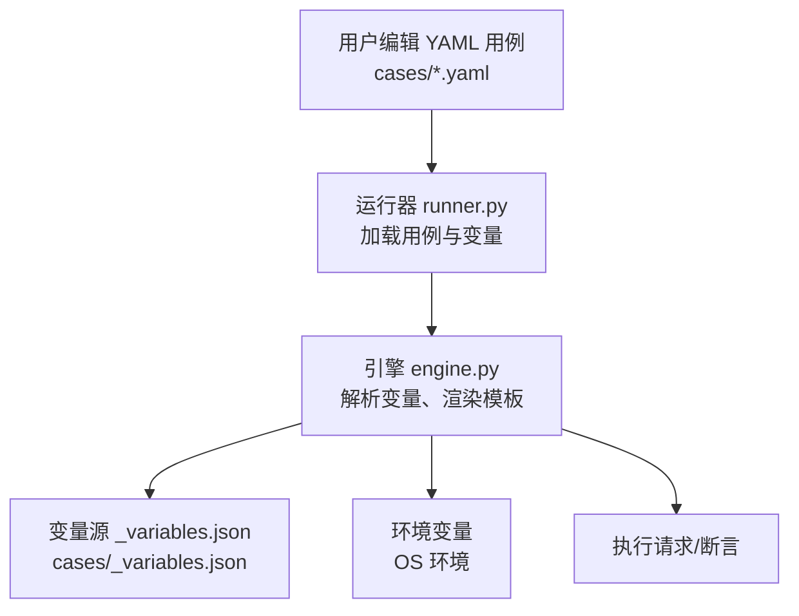
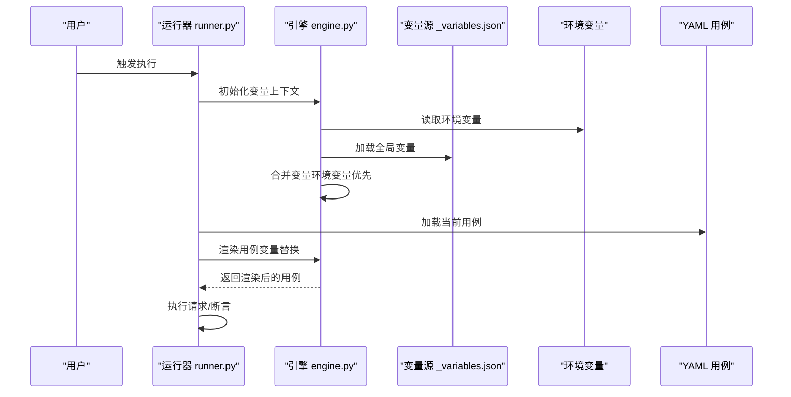
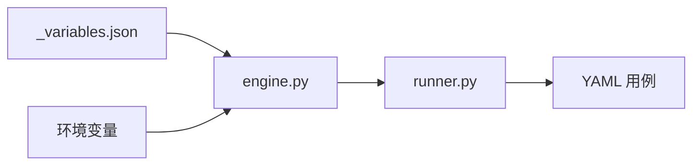

# 变量系统使用

<cite>
**本文引用的文件**   
- [cases/_variables.json](file://cases/_variables.json)
- [cases/1.yaml](file://cases/1.yaml)
- [cases/example.yaml](file://cases/example.yaml)
- [cases/test.yaml](file://cases/test.yaml)
- [cases/员工信息查询.yaml](file://cases/员工信息查询.yaml)
- [cases/比邻星.yaml](file://cases/比邻星.yaml)
- [engine.py](file://engine.py)
- [runner.py](file://runner.py)
- [README.md](file://README.md)
</cite>

## 目录
1. [简介](#简介)
2. [项目结构](#项目结构)
3. [核心组件](#核心组件)
4. [架构总览](#架构总览)
5. [详细组件分析](#详细组件分析)
6. [依赖关系分析](#依赖关系分析)
7. [性能考虑](#性能考虑)
8. [故障排查指南](#故障排查指南)
9. [结论](#结论)
10. [附录](#附录)

## 简介
本指南聚焦于该项目的“变量系统”，帮助你在 YAML 测试用例中高效、安全地使用全局与局部变量。你将了解：
- 全局变量与局部变量的概念与作用域规则
- _variables.json 的结构与配置方式（含环境变量注入与敏感信息管理）
- 在 YAML 中引用变量的语法与高级用法（嵌套访问、条件替换等）
- 常见场景示例（数据库连接、API 密钥管理、动态数据生成）
- 最佳实践与常见问题排查

## 项目结构
本项目采用“用例驱动”的组织方式，YAML 用例位于 cases 目录，变量集中定义在 cases/_variables.json；运行时由 Python 脚本加载并解析变量，再渲染到用例中执行。

图表来源
- [runner.py](file://runner.py)
- [engine.py](file://engine.py)
- [cases/_variables.json](file://cases/_variables.json)

章节来源
- [README.md](file://README.md)

## 核心组件
- 变量源
  - 全局变量：统一维护在 cases/_variables.json，供所有用例共享
  - 环境变量：通过操作系统环境变量注入，优先覆盖 JSON 中的同名键
- 运行器
  - 负责发现用例、加载变量、组装上下文
- 引擎
  - 负责变量解析、模板渲染、作用域合并、错误处理

章节来源
- [cases/_variables.json](file://cases/_variables.json)
- [runner.py](file://runner.py)
- [engine.py](file://engine.py)

## 架构总览
变量系统在运行期按如下流程工作：
- 启动时读取 OS 环境变量
- 加载 cases/_variables.json 作为基础变量集
- 将环境变量与 JSON 变量合并（环境变量优先级更高）
- 在执行每个用例前，将变量注入到渲染上下文
- 在 YAML 中使用占位符引用变量，引擎进行模板渲染后执行

图表来源
- [runner.py](file://runner.py)
- [engine.py](file://engine.py)
- [cases/_variables.json](file://cases/_variables.json)

## 详细组件分析

### 全局变量与 _variables.json
- 文件位置：cases/_variables.json
- 用途：集中存放可被多个用例共享的配置项，如基础 URL、认证信息、通用参数等
- 建议结构：
  - 顶层为对象，键名即变量名
  - 值支持字符串、数字、布尔、数组、对象等 JSON 类型
  - 对于复杂配置，建议使用分层对象组织，便于在 YAML 中通过点号或方括号访问
- 环境变量注入：
  - 若存在同名键，环境变量会覆盖 JSON 中的值
  - 适合用于敏感信息（如密码、密钥），避免写入版本库
- 敏感信息管理：
  - 不要在 _variables.json 中明文存储敏感信息
  - 通过环境变量注入，或在 CI/CD 平台的安全变量管理中提供

章节来源
- [cases/_variables.json](file://cases/_variables.json)

### 变量作用域与引用机制
- 作用域
  - 全局作用域：来自 _variables.json 与环境变量合并后的集合
  - 用例级作用域：可在单个用例内部声明的局部变量（具体语法以用例实现为准）
  - 优先级：局部 > 全局 > 环境变量（当同名冲突时）
- 引用方式
  - 简单引用：在 YAML 中使用占位符引用全局变量
  - 嵌套访问：对对象型变量使用点号或方括号访问子字段
  - 条件替换：根据变量是否存在或取值决定分支逻辑（取决于模板引擎能力）
- 注意事项
  - 未定义的变量在渲染阶段可能报错，需确保路径正确
  - 空值与默认值策略：建议在变量层提供默认值，或在模板层设置回退

章节来源
- [engine.py](file://engine.py)
- [runner.py](file://runner.py)

### 在 YAML 中引用变量
- 简单引用
  - 适用于基本数据类型（字符串、数字、布尔）
- 嵌套对象访问
  - 适用于对象型变量，逐层访问属性
- 条件变量替换
  - 根据变量取值或存在性选择不同分支
- 示例参考
  - 参见以下用例文件，观察变量在不同场景下的使用方式：
    - [cases/1.yaml](file://cases/1.yaml)
    - [cases/example.yaml](file://cases/example.yaml)
    - [cases/test.yaml](file://cases/test.yaml)
    - [cases/员工信息查询.yaml](file://cases/员工信息查询.yaml)
    - [cases/比邻星.yaml](file://cases/比邻星.yaml)

章节来源
- [cases/1.yaml](file://cases/1.yaml)
- [cases/example.yaml](file://cases/example.yaml)
- [cases/test.yaml](file://cases/test.yaml)
- [cases/员工信息查询.yaml](file://cases/员工信息查询.yaml)
- [cases/比邻星.yaml](file://cases/比邻星.yaml)

### 典型场景与最佳实践
- 数据库连接配置
  - 将主机、端口、用户名、密码等拆分为独立键，便于复用与覆盖
  - 敏感字段（如密码）通过环境变量注入
- API 密钥管理
  - 将 BaseURL、Token、Header 等放入全局变量
  - 在 CI/CD 中通过安全变量注入 Token，避免泄露
- 测试数据动态生成
  - 使用时间戳、随机数等外部工具生成数据，并以变量形式注入
  - 在 YAML 中直接引用生成的变量，保持用例简洁

章节来源
- [cases/_variables.json](file://cases/_variables.json)
- [engine.py](file://engine.py)
- [runner.py](file://runner.py)

## 依赖关系分析
变量系统与用例、运行器、引擎之间的依赖关系如下：

图表来源
- [cases/_variables.json](file://cases/_variables.json)
- [engine.py](file://engine.py)
- [runner.py](file://runner.py)

章节来源
- [engine.py](file://engine.py)
- [runner.py](file://runner.py)
- [cases/_variables.json](file://cases/_variables.json)

## 性能考虑
- 变量加载开销较小，主要成本在于模板渲染与网络请求
- 建议：
  - 将稳定配置放入全局变量，减少重复定义
  - 避免在高频循环中重复解析相同变量
  - 大对象尽量按需访问，减少不必要的序列化/反序列化

## 故障排查指南
- 变量未定义或路径错误
  - 检查 _variables.json 中是否包含对应键
  - 确认 YAML 中的引用路径是否正确（层级、大小写）
- 环境变量未生效
  - 确认环境变量已正确设置且名称一致
  - 验证运行器是否在正确的环境中执行（终端、IDE、CI）
- 敏感信息泄露风险
  - 不要将密钥写入 _variables.json
  - 使用环境变量或平台安全变量管理
- 渲染失败
  - 查看引擎抛出的异常信息，定位缺失变量或类型不匹配
  - 逐步缩小范围，先渲染最小用例复现问题

章节来源
- [engine.py](file://engine.py)
- [runner.py](file://runner.py)

## 结论
通过合理组织 _variables.json、善用环境变量、遵循作用域与引用规范，可以在保证安全性的前提下提升用例的可维护性与复用性。建议团队统一变量命名约定，并在 CI/CD 中集中管理敏感信息。

## 附录
- 快速上手清单
  - 在 cases/_variables.json 中定义公共配置
  - 通过环境变量注入敏感信息
  - 在 YAML 中按作用域引用变量
  - 遇到渲染错误时，优先检查变量路径与环境变量
- 参考用例
  - [cases/1.yaml](file://cases/1.yaml)
  - [cases/example.yaml](file://cases/example.yaml)
  - [cases/test.yaml](file://cases/test.yaml)
  - [cases/员工信息查询.yaml](file://cases/员工信息查询.yaml)
  - [cases/比邻星.yaml](file://cases/比邻星.yaml)