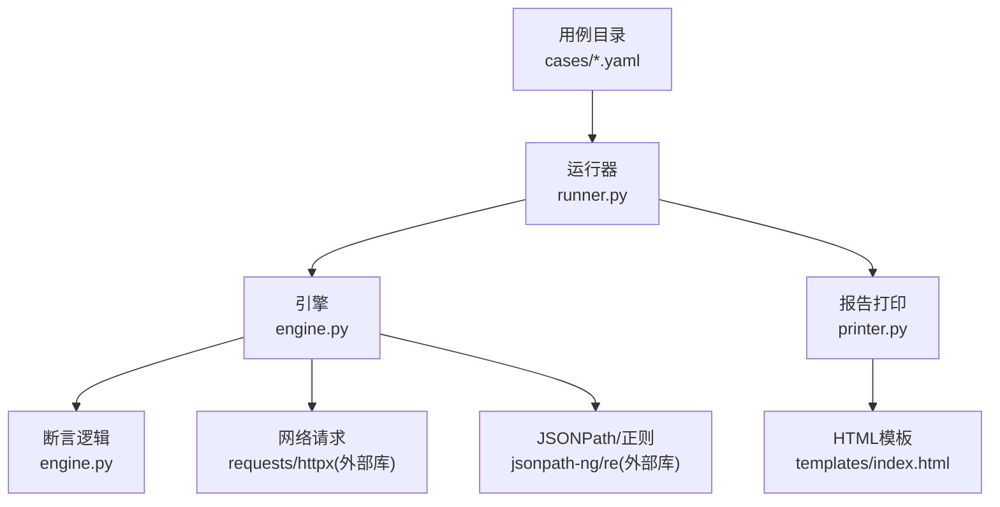
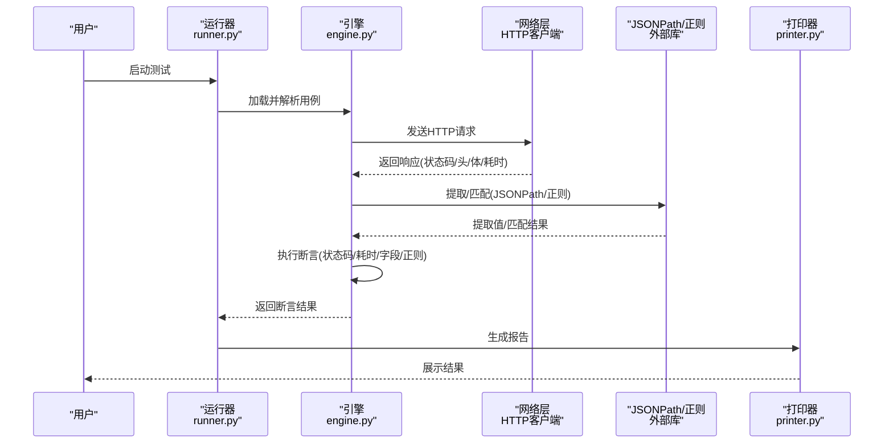
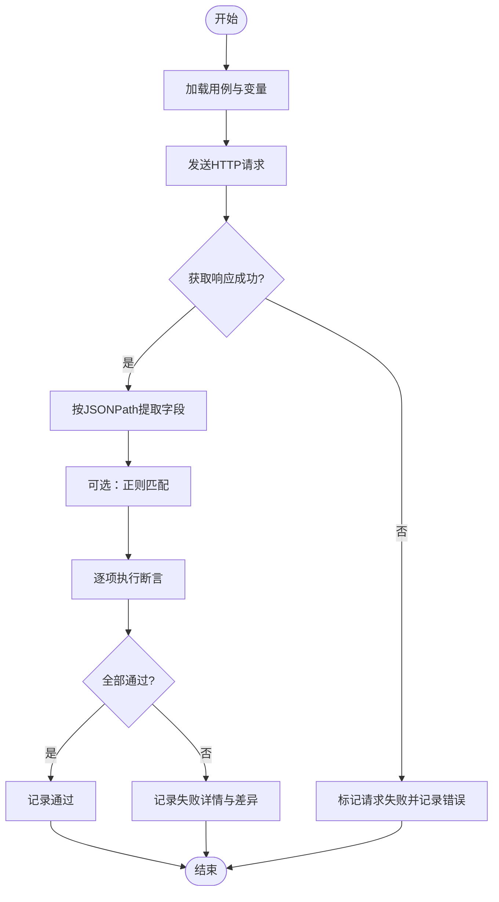
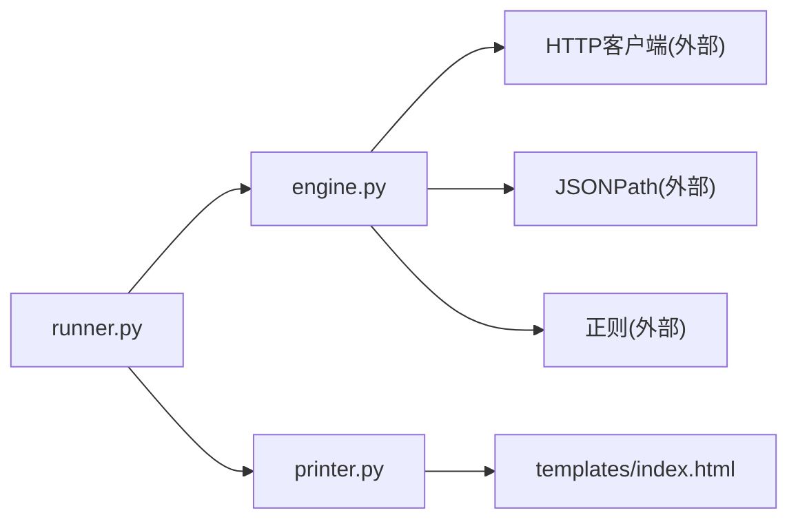

# 断言规则配置

<cite>
**本文引用的文件**   
- [README.md](file://README.md)
- [engine.py](file://engine.py)
- [runner.py](file://runner.py)
- [printer.py](file://printer.py)
- [cases/example.yaml](file://cases/example.yaml)
- [cases/test.yaml](file://cases/test.yaml)
- [cases/1.yaml](file://cases/1.yaml)
- [templates/index.html](file://templates/index.html)
</cite>

## 目录
1. [简介](#简介)
2. [项目结构](#项目结构)
3. [核心组件](#核心组件)
4. [架构总览](#架构总览)
5. [详细组件分析](#详细组件分析)
6. [依赖分析](#依赖分析)
7. [性能考虑](#性能考虑)
8. [故障排查指南](#故障排查指南)
9. [结论](#结论)
10. [附录](#附录)

## 简介
本指南面向使用本仓库进行接口测试与响应验证的工程师，系统化说明“断言规则配置”的使用方法。内容覆盖：
- 状态码验证、响应时间检查
- JSON路径提取与验证（含嵌套对象与数组）
- 正则表达式匹配
- 内置比较与校验函数（如等于、包含、大于、小于等）
- 复杂场景示例（条件断言、组合断言）
- 自定义断言函数的扩展方法
- 失败调试技巧与性能优化建议

## 项目结构
仓库采用“用例驱动 + 引擎执行”的组织方式：
- cases：存放YAML用例，定义请求、变量、断言规则等
- engine.py：解析用例、执行请求、计算断言、汇总结果
- runner.py：编排用例执行流程（顺序/并发、报告输出等）
- printer.py：格式化打印测试结果
- templates/index.html：报告模板（若启用HTML报告）
- README.md：使用说明与快速上手

图表来源
- [runner.py](file://runner.py)
- [engine.py](file://engine.py)
- [printer.py](file://printer.py)
- [templates/index.html](file://templates/index.html)

章节来源
- [README.md](file://README.md)
- [engine.py](file://engine.py)
- [runner.py](file://runner.py)
- [printer.py](file://printer.py)
- [templates/index.html](file://templates/index.html)

## 核心组件
- 用例模型（YAML）
  - 请求定义：URL、方法、头部、参数、体
  - 变量：全局或局部变量，支持引用
  - 断言：对响应状态码、耗时、JSON字段、正则等进行声明式校验
- 引擎（engine.py）
  - 解析用例、渲染变量、发起请求、收集响应
  - 执行断言：按类型逐一评估并记录通过/失败
- 运行器（runner.py）
  - 加载用例集、调度执行、聚合结果
- 打印器（printer.py）
  - 将结果以文本或HTML形式输出

章节来源
- [engine.py](file://engine.py)
- [runner.py](file://runner.py)
- [printer.py](file://printer.py)

## 架构总览
从用例到断言执行的端到端流程如下：

图表来源
- [runner.py](file://runner.py)
- [engine.py](file://engine.py)
- [printer.py](file://printer.py)

## 详细组件分析

### 断言类型与配置要点
- 状态码验证
  - 目标：校验HTTP状态码是否符合预期（单值、集合、范围）
  - 适用场景：接口契约一致性、错误分支覆盖
- 响应时间检查
  - 目标：校验请求耗时是否满足阈值（毫秒/秒）
  - 适用场景：性能基线回归、慢查询定位
- JSON路径提取与验证
  - 目标：基于JSONPath定位字段，再结合比较/包含/长度等断言
  - 适用场景：结构化响应校验、嵌套对象与数组元素检查
- 正则表达式匹配
  - 目标：对字符串字段进行模式匹配
  - 适用场景：日志片段、令牌、ID格式、消息体片段校验
- 条件断言与组合断言
  - 目标：根据上下文变量或前序断言结果动态选择断言策略
  - 适用场景：多环境差异、幂等性校验、容错分支

章节来源
- [engine.py](file://engine.py)
- [cases/example.yaml](file://cases/example.yaml)
- [cases/test.yaml](file://cases/test.yaml)
- [cases/1.yaml](file://cases/1.yaml)

### 内置断言函数与操作符
以下为常用内置断言能力（名称为概念描述，具体键名以实际实现为准）：
- 相等性
  - equals：精确相等（支持数值、布尔、字符串）
- 包含关系
  - contains：子串/子列表/键存在性
- 大小比较
  - greater_than / less_than：数值比较
  - greater_or_equal / less_or_equal：带等号的比较
- 长度与边界
  - length_equals / length_greater_than / length_less_than：序列/字符串长度约束
- 空值与存在性
  - is_null / is_not_null / exists：字段存在性与空值判断
- 正则匹配
  - matches：基于正则表达式的匹配
- 集合与唯一性
  - all_match / any_match / unique：集合级断言
- 时间与时区
  - within_seconds / before / after：时间戳比较

使用建议：
- 优先使用强类型比较（数值用数值比较，字符串用contains/matches）
- 对浮点数比较时注意精度问题，必要时先做round处理
- 对大型响应体，尽量缩小JSONPath范围，减少内存占用

章节来源
- [engine.py](file://engine.py)

### 复杂断言场景示例
- 嵌套JSON数据验证
  - 使用JSONPath定位深层字段，再进行equals/contains等断言
  - 适用于多级对象、字典映射、枚举值校验
- 数组元素检查
  - 使用索引或all_match/any_match对数组元素进行批量断言
  - 可结合length_*断言确保元素数量符合预期
- 条件断言逻辑
  - 依据变量或前序断言结果，动态切换断言策略
  - 适用于多环境、灰度发布、降级开关等场景

章节来源
- [cases/example.yaml](file://cases/example.yaml)
- [cases/test.yaml](file://cases/test.yaml)
- [cases/1.yaml](file://cases/1.yaml)
- [engine.py](file://engine.py)

### 自定义断言函数与扩展机制
- 扩展点位置
  - 在引擎中注册自定义断言处理器，使新的断言类型可用
- 开发步骤
  - 定义断言函数：接收期望值与实际值，返回布尔或断言结果对象
  - 注册到断言表：将新类型键映射到对应函数
  - 在YAML用例中使用新断言类型
- 注意事项
  - 保持函数幂等与无副作用
  - 提供清晰的错误信息，便于失败定位
  - 避免阻塞型IO，保证断言执行高效

章节来源
- [engine.py](file://engine.py)

### 断言执行流程图

图表来源
- [engine.py](file://engine.py)

## 依赖分析
- 内部模块耦合
  - runner.py 依赖 engine.py 完成用例执行与断言
  - engine.py 依赖外部库进行网络请求、JSONPath解析与正则匹配
  - printer.py 负责将结果渲染为文本或HTML
- 外部依赖
  - HTTP客户端：用于发起请求与读取响应
  - JSONPath库：用于路径提取
  - 正则库：用于模式匹配
  - HTML模板：用于报告展示

图表来源
- [runner.py](file://runner.py)
- [engine.py](file://engine.py)
- [printer.py](file://printer.py)
- [templates/index.html](file://templates/index.html)

章节来源
- [runner.py](file://runner.py)
- [engine.py](file://engine.py)
- [printer.py](file://printer.py)
- [templates/index.html](file://templates/index.html)

## 性能考虑
- 减少不必要的JSON解析
  - 仅在需要时使用JSONPath；对纯文本断言直接走正则或字符串匹配
- 限制断言范围
  - 精准定位JSONPath，避免全量遍历大对象
- 控制并发度
  - 合理设置并发数，避免压垮被测服务或本地资源
- 复用连接与缓存
  - 复用HTTP连接、预编译正则表达式、缓存公共变量
- 选择性断言
  - 在回归阶段仅保留关键断言，提升执行速度

[本节为通用指导，不直接分析具体文件]

## 故障排查指南
- 常见失败原因
  - JSONPath不存在或拼写错误
  - 正则表达式过于严格导致误判
  - 数值精度导致的比较失败
  - 响应体过大导致内存压力
- 定位技巧
  - 开启详细日志，查看提取值与期望值的差异
  - 逐步缩小断言范围，先验证关键字段，再扩展到复杂结构
  - 使用最小化用例复现问题
- 报告辅助
  - 利用HTML报告中的断言明细与堆栈信息快速定位

章节来源
- [printer.py](file://printer.py)
- [templates/index.html](file://templates/index.html)

## 结论
通过声明式断言与丰富的内置函数，本工具能够覆盖从基础状态码到复杂嵌套结构的全面验证需求。配合自定义断言扩展与完善的调试手段，可在保证正确性的同时兼顾执行效率。建议在团队内统一断言规范，沉淀常用断言模板，持续提升回归质量与稳定性。

## 附录
- 快速上手
  - 参考README了解安装与运行方式
  - 在cases目录下编写YAML用例，逐步添加断言
- 参考用例
  - example.yaml、test.yaml、1.yaml 可作为断言语法与最佳实践参考

章节来源
- [README.md](file://README.md)
- [cases/example.yaml](file://cases/example.yaml)
- [cases/test.yaml](file://cases/test.yaml)
- [cases/1.yaml](file://cases/1.yaml)