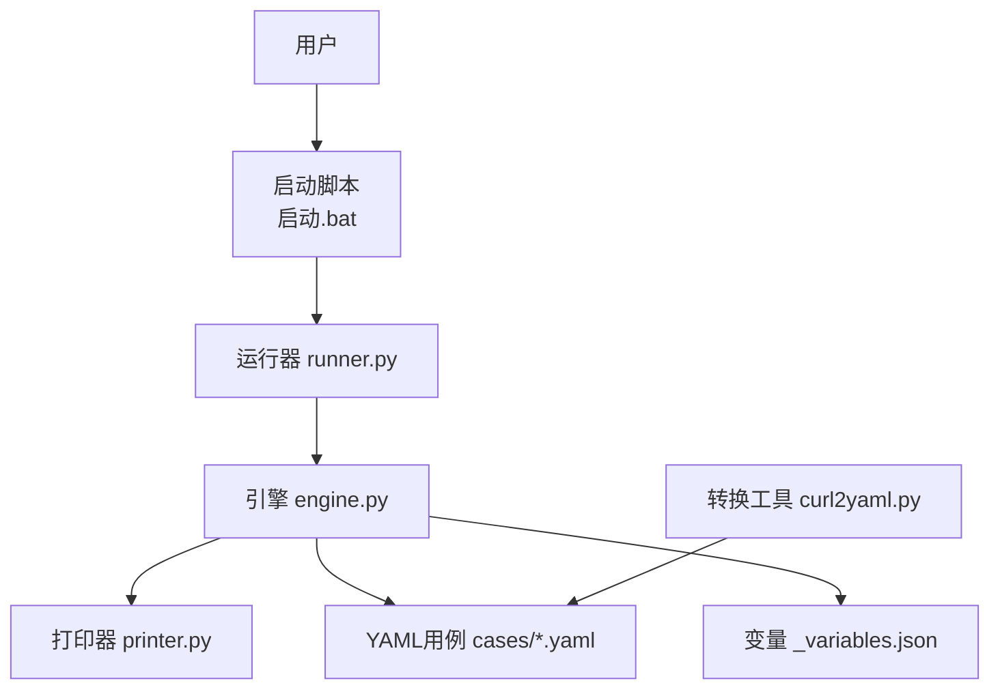
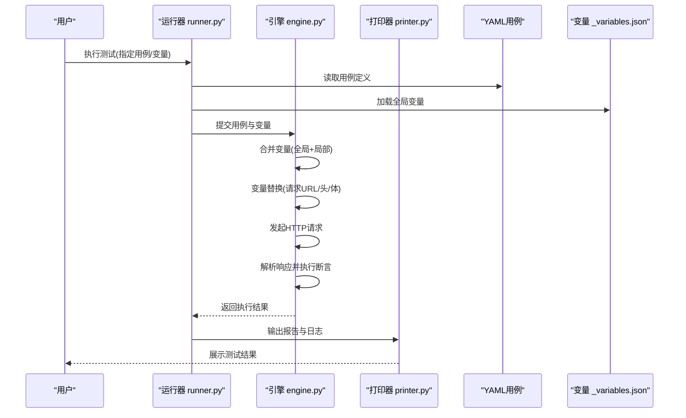
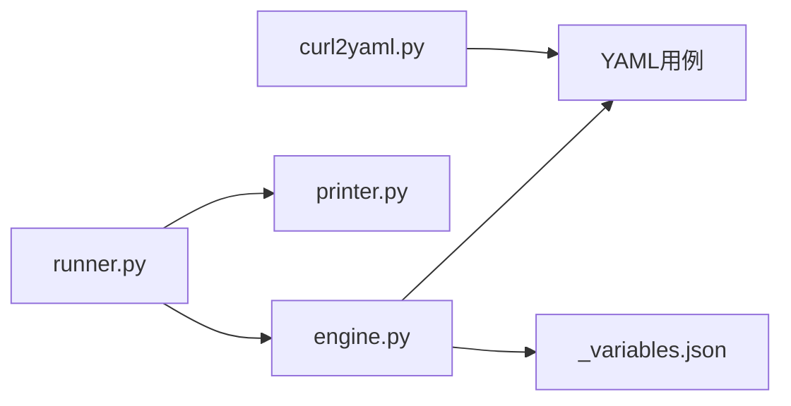

# 测试用例编写指南

<cite>
**本文引用的文件**   
- [README.md](file://README.md)
- [SKILL.md](file://SKILL.md)
- [engine.py](file://engine.py)
- [runner.py](file://runner.py)
- [printer.py](file://printer.py)
- [curl2yaml.py](file://curl2yaml.py)
- [cases/1.yaml](file://cases/1.yaml)
- [cases/example.yaml](file://cases/example.yaml)
- [cases/test.yaml](file://cases/test.yaml)
- [cases/_variables.json](file://cases/_variables.json)
</cite>

## 目录
1. [简介](#简介)
2. [项目结构](#项目结构)
3. [核心组件](#核心组件)
4. [架构总览](#架构总览)
5. [详细组件分析](#详细组件分析)
6. [依赖关系分析](#依赖关系分析)
7. [性能与稳定性建议](#性能与稳定性建议)
8. [故障排查指南](#故障排查指南)
9. [结论](#结论)
10. [附录：YAML配置语法与变量系统](#附录yaml配置语法与变量系统)

## 简介
本指南面向使用本项目进行API接口测试的读者，目标是帮助你从零开始编写高质量、可维护的测试用例。你将了解：
- YAML测试用例的语法规范与结构定义（请求方法、URL、头部、请求体、断言等）
- 变量系统的概念与用法（全局变量与局部变量的定义、引用与替换机制）
- 常见测试场景示例（GET/POST、文件上传、认证处理、条件断言等）
- 最佳实践与常见错误避免方法

## 项目结构
仓库采用“用例驱动”的组织方式，核心由引擎与运行器组成，测试用例以YAML形式存放于专用目录，变量集中管理，并提供从cURL到YAML的转换工具。

图表来源
- [runner.py](file://runner.py)
- [engine.py](file://engine.py)
- [printer.py](file://printer.py)
- [curl2yaml.py](file://curl2yaml.py)
- [cases/1.yaml](file://cases/1.yaml)
- [cases/example.yaml](file://cases/example.yaml)
- [cases/test.yaml](file://cases/test.yaml)
- [cases/_variables.json](file://cases/_variables.json)

章节来源
- [README.md](file://README.md)
- [SKILL.md](file://SKILL.md)

## 核心组件
- 运行器 runner.py：负责加载用例、解析参数、调度执行流程、汇总结果与输出报告。
- 引擎 engine.py：实现HTTP请求发送、变量替换、断言校验、响应处理等核心逻辑。
- 打印器 printer.py：格式化输出测试结果、日志与调试信息。
- 转换工具 curl2yaml.py：将cURL命令转换为YAML用例模板，加速用例创建。
- 用例目录 cases：存放所有YAML用例与共享变量。

章节来源
- [runner.py](file://runner.py)
- [engine.py](file://engine.py)
- [printer.py](file://printer.py)
- [curl2yaml.py](file://curl2yaml.py)

## 架构总览
下图展示了从命令行触发到用例执行的端到端流程，包括变量注入、请求构造、断言与结果输出。

图表来源
- [runner.py](file://runner.py)
- [engine.py](file://engine.py)
- [printer.py](file://printer.py)
- [cases/1.yaml](file://cases/1.yaml)
- [cases/_variables.json](file://cases/_variables.json)

## 详细组件分析

### 运行器 runner.py
职责
- 解析命令行参数或配置文件，确定要执行的用例集合。
- 加载YAML用例与变量文件，组装上下文。
- 调用引擎执行单条或多条用例，收集结果。
- 控制输出格式与退出码，便于集成CI/CD。

关键流程
- 初始化与参数解析
- 用例发现与过滤
- 变量加载与合并
- 执行循环与结果聚合
- 报告生成与导出

章节来源
- [runner.py](file://runner.py)

### 引擎 engine.py
职责
- 变量系统：支持全局变量与局部变量，提供引用与替换能力。
- 请求构造：根据YAML配置生成HTTP请求（方法、URL、头部、请求体、文件等）。
- 断言执行：对状态码、响应体字段、JSON路径等进行校验。
- 错误处理：统一捕获网络异常、解析异常与断言失败，记录详细信息。

关键流程
- 加载并解析YAML用例
- 合并变量作用域（全局→局部→运行时）
- 变量替换（字符串插值、表达式求值）
- 发送请求与重试策略
- 断言规则匹配与失败定位
- 结果封装与上报

章节来源
- [engine.py](file://engine.py)

### 打印器 printer.py
职责
- 将执行结果渲染为可读文本或结构化数据。
- 输出断言详情、差异对比与调试信息。
- 支持不同输出级别（静默、普通、详细）。

章节来源
- [printer.py](file://printer.py)

### 转换工具 curl2yaml.py
用途
- 将常见的cURL命令转换为YAML用例骨架，减少手工编写成本。
- 自动提取方法、URL、头部与请求体，保留占位符以便后续完善。

章节来源
- [curl2yaml.py](file://curl2yaml.py)

### 用例与变量样例
- 用例样例：cases/1.yaml、cases/example.yaml、cases/test.yaml
- 全局变量：cases/_variables.json

章节来源
- [cases/1.yaml](file://cases/1.yaml)
- [cases/example.yaml](file://cases/example.yaml)
- [cases/test.yaml](file://cases/test.yaml)
- [cases/_variables.json](file://cases/_variables.json)

## 依赖关系分析
- runner.py 依赖 engine.py 与 printer.py，作为编排层协调执行与输出。
- engine.py 依赖YAML解析库、HTTP客户端与断言库（具体第三方库以实际导入为准）。
- curl2yaml.py 独立工具，不耦合运行期逻辑，便于离线生成用例。

图表来源
- [runner.py](file://runner.py)
- [engine.py](file://engine.py)
- [printer.py](file://printer.py)
- [curl2yaml.py](file://curl2yaml.py)
- [cases/1.yaml](file://cases/1.yaml)
- [cases/_variables.json](file://cases/_variables.json)

章节来源
- [runner.py](file://runner.py)
- [engine.py](file://engine.py)
- [printer.py](file://printer.py)
- [curl2yaml.py](file://curl2yaml.py)

## 性能与稳定性建议
- 批量执行时合理分页与并发度，避免瞬时压力过大导致目标服务限流。
- 复用连接与会话（如Cookie/Token），减少重复登录开销。
- 对大响应体启用按需断言，避免全量解析带来的内存与CPU消耗。
- 使用变量缓存与惰性替换，降低重复计算。
- 在CI中设置超时与重试上限，保证流水线稳定。

[本节为通用建议，无需代码来源]

## 故障排查指南
常见问题与定位思路
- 变量未生效
  - 检查变量作用域顺序：全局→局部→运行时覆盖。
  - 确认变量键名拼写与大小写一致。
  - 查看打印器的详细日志，确认替换阶段是否命中。
- 请求失败
  - 核对URL、方法与头部是否正确拼接。
  - 检查代理、证书与超时配置。
  - 关注网络异常与重试策略。
- 断言失败
  - 定位具体断言项与期望值。
  - 使用详细模式输出响应片段与差异。
  - 若为动态数据，考虑引入变量或放宽断言范围。
- 用例无法加载
  - 检查YAML语法与缩进。
  - 确认文件路径与编码。
  - 使用转换工具快速验证骨架正确性。

章节来源
- [printer.py](file://printer.py)
- [engine.py](file://engine.py)
- [runner.py](file://runner.py)

## 结论
通过本指南，你可以掌握基于YAML的API测试用例编写方法，理解变量系统与执行流程，并能高效地构建覆盖常见场景的测试套件。结合最佳实践与排错技巧，可显著提升用例的可维护性与稳定性。

[本节为总结性内容，无需代码来源]

## 附录：YAML配置语法与变量系统

### YAML用例结构要点
- 基本信息
  - 名称、描述、标签等元数据，便于检索与分组。
- 请求定义
  - 方法：GET/POST/PUT/DELETE/PATCH等。
  - URL：支持绝对地址与相对路径，允许变量占位。
  - 头部：Content-Type、Authorization、自定义Header等。
  - 请求体：JSON、表单、纯文本等，支持变量替换。
  - 文件上传：多部分表单字段与文件字段组合。
- 断言规则
  - 状态码断言：期望HTTP状态码。
  - 响应体断言：JSON路径取值与比较（等于、包含、正则、长度、非空等）。
  - 响应头断言：特定Header存在或取值匹配。
  - 条件断言：基于前序步骤或变量值的分支判断。
- 步骤组织
  - 单步用例：一次请求+一组断言。
  - 多步用例：按顺序执行多个请求，支持变量传递与中间结果引用。

章节来源
- [cases/1.yaml](file://cases/1.yaml)
- [cases/example.yaml](file://cases/example.yaml)
- [cases/test.yaml](file://cases/test.yaml)

### 变量系统概念与使用模式
- 变量来源与作用域
  - 全局变量：存放在共享文件中，供所有用例访问。
  - 局部变量：在单个用例内声明，仅在该用例范围内有效。
  - 运行时变量：由上一步响应中提取并注入，用于后续步骤。
- 引用与替换
  - 占位符语法：在URL、头部、请求体中使用占位符引用变量。
  - 替换时机：在请求发送前完成变量解析与替换。
  - 覆盖优先级：运行时 > 局部 > 全局。
- 变量提取
  - 从响应体或头部提取值，保存为变量供后续使用。
  - 支持JSON路径与正则提取。
- 安全与敏感信息
  - 敏感变量（如密钥）建议使用外部配置或环境变量注入，避免硬编码。

章节来源
- [cases/_variables.json](file://cases/_variables.json)
- [engine.py](file://engine.py)

### 常见测试场景示例（说明性）
- GET请求
  - 构造简单查询参数，断言状态码与关键字段。
- POST请求
  - 提交JSON或表单数据，断言返回结构与业务字段。
- 文件上传
  - 使用多部分表单，上传文件并校验服务端返回的文件标识或URL。
- 认证处理
  - 先登录获取令牌，将令牌注入后续请求的头部，实现鉴权访问。
- 条件断言
  - 根据环境或前置步骤的结果，选择不同断言策略或跳过某些步骤。

[本节为概念性说明，无需代码来源]

### 最佳实践
- 用例命名清晰，包含模块与目的，便于检索与回归。
- 将公共数据抽离为变量，保持用例简洁与可复用。
- 断言聚焦关键路径，兼顾正确性与鲁棒性。
- 使用转换工具快速生成用例骨架，再逐步完善断言与变量。
- 在CI中隔离敏感变量，使用受控的环境配置。

[本节为通用建议，无需代码来源]

### 常见错误与避免方法
- YAML缩进与语法错误：确保缩进一致，避免Tab与空格混用。
- 变量未定义或拼写错误：统一在变量中心管理，使用前进行静态检查。
- 断言过于严格：对时间戳、随机ID等动态字段采用宽松匹配或忽略。
- 请求体过大：按需断言，避免全量解析造成性能问题。
- 并发过高：合理控制并发度，避免对目标服务造成压力。

[本节为通用建议，无需代码来源]