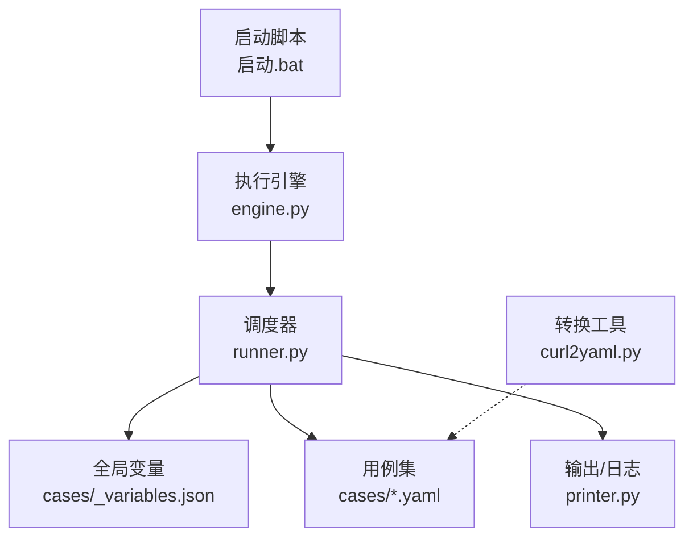
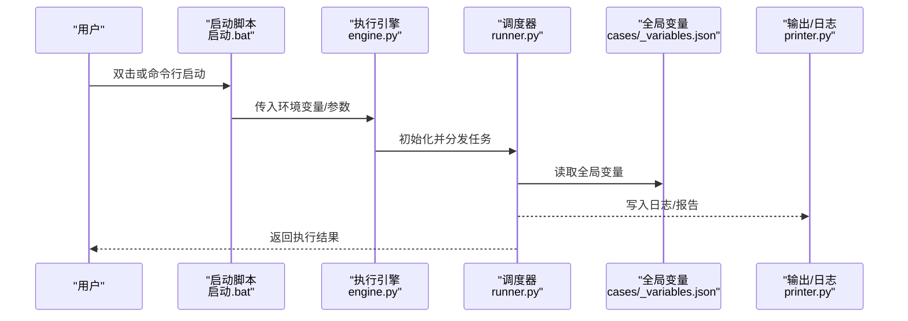
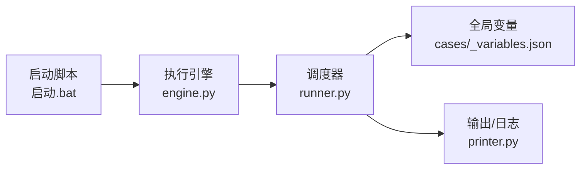

# 配置参考手册

<cite>
**本文引用的文件**   
- [README.md](file://README.md)
- [_variables.json](file://cases/_variables.json)
- [启动.bat](file://启动.bat)
- [engine.py](file://engine.py)
- [runner.py](file://runner.py)
- [printer.py](file://printer.py)
- [curl2yaml.py](file://curl2yaml.py)
</cite>

## 目录
1. [简介](#简介)
2. [项目结构](#项目结构)
3. [核心组件](#核心组件)
4. [架构总览](#架构总览)
5. [详细组件分析](#详细组件分析)
6. [依赖关系分析](#依赖关系分析)
7. [性能考虑](#性能考虑)
8. [故障排查指南](#故障排查指南)
9. [结论](#结论)
10. [附录](#附录)

## 简介
本手册面向使用该仓库进行接口测试与用例管理的用户，聚焦“配置”主题，提供：
- 全局变量配置文件 _variables.json 的字段定义、数据类型与默认值说明
- 启动脚本的配置方法与环境变量设置
- 不同部署环境（开发、测试、生产）的差异化配置示例
- 配置校验规则与常见错误提示，帮助快速定位并解决问题

## 项目结构
仓库采用“用例 + 引擎 + 工具脚本”的轻量组织方式。与配置相关的关键位置如下：
- cases/_variables.json：全局变量集中管理
- 启动.bat：Windows 一键启动入口，支持通过环境变量覆盖运行参数
- engine.py / runner.py：执行引擎与调度器，负责加载配置、驱动用例执行
- printer.py：输出格式化与日志打印
- curl2yaml.py：辅助工具，将 curl 命令转换为 YAML 用例（与配置无关但常配合使用）

图表来源
- [启动.bat](file://启动.bat)
- [engine.py](file://engine.py)
- [runner.py](file://runner.py)
- [_variables.json](file://cases/_variables.json)
- [printer.py](file://printer.py)
- [curl2yaml.py](file://curl2yaml.py)

章节来源
- [README.md](file://README.md)
- [启动.bat](file://启动.bat)
- [engine.py](file://engine.py)
- [runner.py](file://runner.py)
- [printer.py](file://printer.py)
- [curl2yaml.py](file://curl2yaml.py)

## 核心组件
本节聚焦配置相关的核心对象与流程：
- 全局变量配置：_variables.json
- 启动与环境：启动.bat 与系统环境变量
- 运行时加载：engine.py / runner.py 对配置的读取与合并策略
- 输出与可观测性：printer.py 的日志与报告输出

章节来源
- [_variables.json](file://cases/_variables.json)
- [启动.bat](file://启动.bat)
- [engine.py](file://engine.py)
- [runner.py](file://runner.py)
- [printer.py](file://printer.py)

## 架构总览
下图展示从启动到用例执行的配置加载链路，以及各模块的职责边界。

图表来源
- [启动.bat](file://启动.bat)
- [engine.py](file://engine.py)
- [runner.py](file://runner.py)
- [_variables.json](file://cases/_variables.json)
- [printer.py](file://printer.py)

## 详细组件分析

### 全局变量配置：_variables.json
该文件用于集中管理跨用例的全局变量。建议按以下维度组织键名：
- 基础信息：应用名称、版本、描述等
- 环境标识：环境名、地域、集群等
- 连接信息：目标服务地址、端口、协议、超时、重试次数等
- 认证凭据：令牌、密钥、用户名/密码等（注意敏感信息保护）
- 业务开关：功能开关、灰度比例、降级策略等
- 数据种子：初始数据、批量大小、分页大小等
- 输出控制：日志级别、是否生成报告、报告路径等

字段规范建议
- 键名：小写字母、数字、下划线；避免空格与特殊字符
- 类型：string、number、boolean、array、object
- 必填项：至少包含“环境标识”和“连接信息”必要键
- 默认值：在代码中为可选键提供合理默认值，未显式配置时生效
- 安全：敏感字段建议使用环境变量注入，不在文件中明文存储

校验规则建议
- 存在性校验：关键键缺失时报错并终止执行
- 类型校验：非预期类型时给出明确提示
- 范围校验：数值型字段需满足最小/最大限制
- 格式校验：URL、邮箱、时间戳等格式校验
- 互斥/依赖校验：某些键组合互斥或必须同时出现

错误提示建议
- 明确指出缺失键名、期望类型、所在层级
- 提供修复建议与示例键名
- 区分致命错误（无法继续）与非致命警告（可降级）

章节来源
- [_variables.json](file://cases/_variables.json)

### 启动脚本与环境变量：启动.bat
启动脚本是 Windows 环境的一键入口，通常承担以下职责：
- 设置或覆盖环境变量（如日志级别、目标环境、并发数等）
- 调用执行引擎并传递参数
- 捕获退出码并输出简要结果

常用环境变量建议
- APP_ENV：运行环境（dev/test/prod），影响配置加载优先级
- LOG_LEVEL：日志级别（DEBUG/INFO/WARN/ERROR）
- TARGET_URL：目标服务基址，便于统一切换
- MAX_RETRIES：请求重试次数
- TIMEOUT_MS：请求超时毫秒数
- REPORT_DIR：报告输出目录
- CASES_PATH：用例目录路径

启动方式建议
- 直接双击启动：使用脚本内默认环境变量
- 命令行启动：先 set 环境变量再执行脚本，实现灵活覆盖
- 批处理封装：结合计划任务或 CI 流水线自动触发

章节来源
- [启动.bat](file://启动.bat)

### 执行引擎与调度器：engine.py / runner.py
- engine.py：负责初始化上下文、解析参数、选择配置源、组装执行环境
- runner.py：负责加载用例、注入变量、驱动执行、汇总结果与输出

配置加载顺序（建议）
- 默认配置（内置）
- 全局变量文件（_variables.json）
- 环境变量（覆盖全局变量）
- 命令行参数（最高优先级）

注意事项
- 避免循环依赖与重复加载
- 对不可用配置提供回退策略
- 记录最终生效的配置快照，便于审计与复现

章节来源
- [engine.py](file://engine.py)
- [runner.py](file://runner.py)

### 输出与日志：printer.py
- 统一日志格式与级别
- 结构化输出（JSON/文本）
- 报告生成与归档
- 异常堆栈与上下文信息收集

章节来源
- [printer.py](file://printer.py)

### 辅助工具：curl2yaml.py
- 将 curl 命令转换为 YAML 用例，便于复用与维护
- 与 _variables.json 配合，将公共参数抽离至全局变量

章节来源
- [curl2yaml.py](file://curl2yaml.py)

## 依赖关系分析
配置相关模块之间的依赖关系如下：

图表来源
- [启动.bat](file://启动.bat)
- [engine.py](file://engine.py)
- [runner.py](file://runner.py)
- [_variables.json](file://cases/_variables.json)
- [printer.py](file://printer.py)

章节来源
- [启动.bat](file://启动.bat)
- [engine.py](file://engine.py)
- [runner.py](file://runner.py)
- [_variables.json](file://cases/_variables.json)
- [printer.py](file://printer.py)

## 性能考虑
- 减少不必要的配置重读：在进程生命周期内缓存已解析的配置
- 大对象按需加载：仅在执行需要时加载大型数据集
- 并行执行时的隔离：确保每个用例拥有独立的变量副本，避免共享状态污染
- I/O 优化：批量写入日志与报告，降低频繁磁盘操作开销

## 故障排查指南
常见问题与定位步骤
- 启动失败
  - 检查启动脚本是否存在语法错误或权限问题
  - 确认环境变量是否正确设置且未被后续逻辑覆盖
- 找不到全局变量文件
  - 核对 _variables.json 路径与文件名
  - 检查当前工作目录与相对路径解析
- 配置类型不匹配
  - 根据错误提示修正字段类型
  - 若为可选字段，确认是否提供了默认值
- 网络或超时问题
  - 调整 TARGET_URL、TIMEOUT_MS、MAX_RETRIES
  - 检查代理与证书配置（如有）
- 日志与报告缺失
  - 确认 REPORT_DIR 可写
  - 检查 LOG_LEVEL 与输出路径

章节来源
- [启动.bat](file://启动.bat)
- [_variables.json](file://cases/_variables.json)
- [engine.py](file://engine.py)
- [runner.py](file://runner.py)
- [printer.py](file://printer.py)

## 结论
通过统一的 _variables.json 与启动脚本的环境变量机制，本项目实现了灵活的配置管理与多环境适配。建议在团队内建立配置命名规范与校验规则，并结合日志与报告提升可观测性与可维护性。

## 附录

### 不同环境的配置示例（概念性）
- 开发环境
  - 目标地址指向本地或沙箱
  - 日志级别设为 DEBUG
  - 关闭严格校验以加速迭代
- 测试环境
  - 目标地址指向测试集群
  - 开启完整断言与报告
  - 启用重试与限流
- 生产环境
  - 目标地址指向线上域名
  - 日志级别 INFO 及以上
  - 启用告警与审计
  - 禁用调试开关与冗余输出

[本节为概念性说明，无需源码引用]