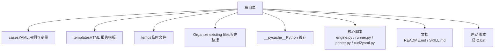
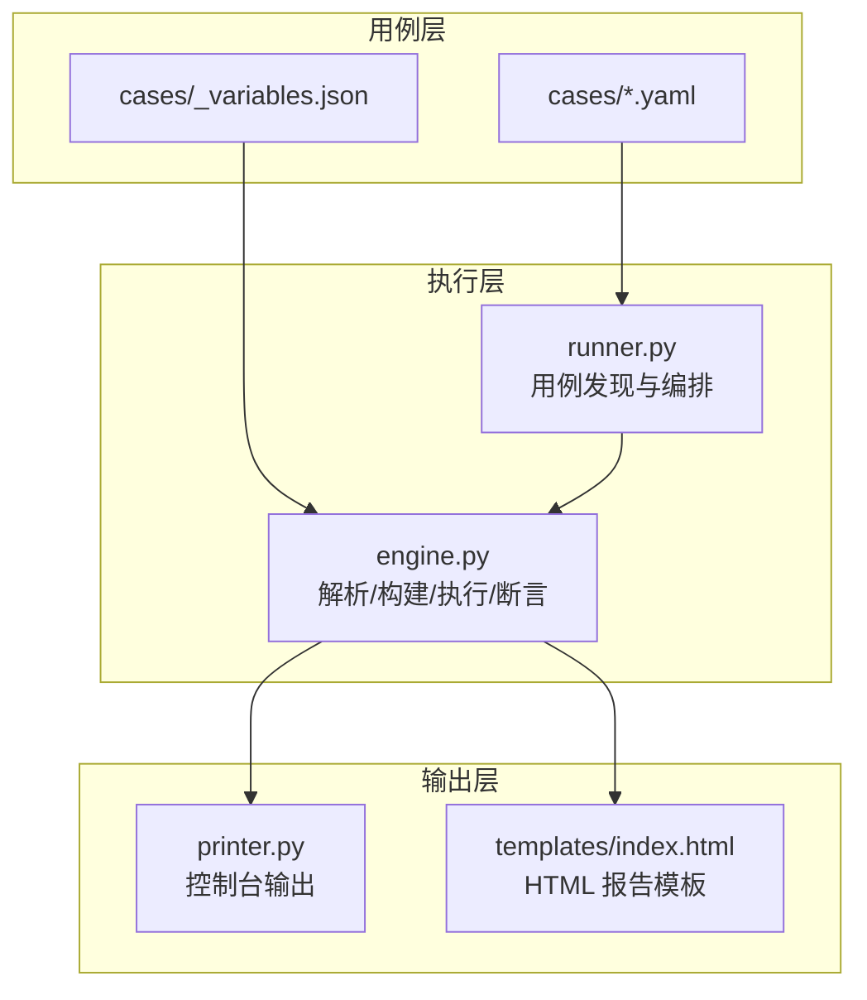
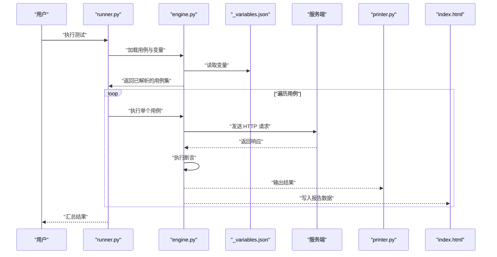
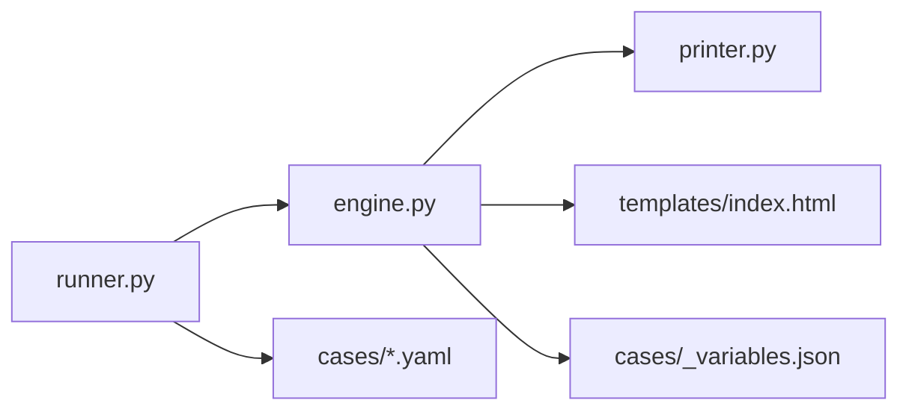

# 项目概述

<cite>
**本文引用的文件**   
- [README.md](file://README.md)
- [SKILL.md](file://SKILL.md)
- [engine.py](file://engine.py)
- [runner.py](file://runner.py)
- [printer.py](file://printer.py)
- [curl2yaml.py](file://curl2yaml.py)
- [启动.bat](file://启动.bat)
- [cases/1.yaml](file://cases/1.yaml)
- [cases/example.yaml](file://cases/example.yaml)
- [cases/_variables.json](file://cases/_variables.json)
- [templates/index.html](file://templates/index.html)
</cite>

## 目录
1. [简介](#简介)
2. [项目结构](#项目结构)
3. [核心组件](#核心组件)
4. [架构总览](#架构总览)
5. [详细组件分析](#详细组件分析)
6. [依赖关系分析](#依赖关系分析)
7. [性能考量](#性能考量)
8. [故障排查指南](#故障排查指南)
9. [结论](#结论)
10. [附录](#附录)

## 简介
本项目是一个基于 Python 的轻量级 API 测试工具，采用 YAML 驱动的方式组织与执行测试用例，内置变量管理系统、HTTP 请求执行、响应断言验证以及 HTML 报告生成等能力。其设计理念强调“声明式用例 + 可复用变量 + 易读报告”，适合接口回归、联调验证、持续集成等多种场景。

主要特性概览：
- YAML 驱动测试：以可读性强的 YAML 描述请求、参数、断言与期望结果，便于维护与协作。
- 变量管理：支持在用例间共享与传递变量，减少重复配置，提升用例复用度。
- HTTP 执行：封装常用 HTTP 方法，统一处理请求头、查询参数、表单与 JSON 载荷。
- 响应验证：提供丰富的断言能力，覆盖状态码、响应体字段、时间戳、正则匹配等。
- HTML 报告：自动生成可视化报告，便于快速定位失败用例与问题根因。
- 便捷转换：提供 curl 到 YAML 的转换脚本，降低上手门槛。

适用场景：
- 接口回归与冒烟测试
- 前后端联调与契约校验
- CI/CD 流水线中的自动化验证
- 教学与演示环境下的快速验证

## 项目结构
仓库采用“核心引擎 + 用例 + 模板”的分层组织方式，便于扩展与维护。

图示来源
- [README.md:1-20](file://README.md#L1-L20)
- [SKILL.md:1-20](file://SKILL.md#L1-L20)
- [engine.py:1-40](file://engine.py#L1-L40)
- [runner.py:1-40](file://runner.py#L1-L40)
- [printer.py:1-40](file://printer.py#L1-L40)
- [curl2yaml.py:1-40](file://curl2yaml.py#L1-L40)
- [启动.bat:1-20](file://启动.bat#L1-L20)

章节来源
- [README.md:1-20](file://README.md#L1-L20)
- [SKILL.md:1-20](file://SKILL.md#L1-L20)
- [启动.bat:1-20](file://启动.bat#L1-L20)

## 核心组件
- 用例定义与变量
  - YAML 用例：描述目标 URL、方法、请求头、参数、断言与期望值。
  - 变量文件：集中管理跨用例复用的数据，如鉴权令牌、公共路径等。
- 引擎与运行器
  - 引擎：负责解析 YAML、加载变量、构建请求、发送 HTTP 调用、执行断言。
  - 运行器：编排用例发现、顺序执行、统计与汇总。
- 打印与报告
  - 打印器：格式化输出测试结果，便于控制台查看。
  - 报告模板：渲染为 HTML，展示用例明细、失败原因与耗时。
- 辅助工具
  - curl 转 YAML：将 curl 命令转换为 YAML 用例，加速用例编写。
  - 启动脚本：一键执行测试流程，简化日常使用。

章节来源
- [engine.py:1-40](file://engine.py#L1-L40)
- [runner.py:1-40](file://runner.py#L1-L40)
- [printer.py:1-40](file://printer.py#L1-L40)
- [curl2yaml.py:1-40](file://curl2yaml.py#L1-L40)
- [启动.bat:1-20](file://启动.bat#L1-L20)
- [cases/_variables.json:1-20](file://cases/_variables.json#L1-L20)
- [cases/example.yaml:1-20](file://cases/example.yaml#L1-L20)

## 架构总览
整体采用“声明式用例 + 引擎执行 + 报告输出”的三层架构，模块职责清晰、耦合度低。

图示来源
- [runner.py:1-40](file://runner.py#L1-L40)
- [engine.py:1-40](file://engine.py#L1-L40)
- [printer.py:1-40](file://printer.py#L1-L40)
- [templates/index.html:1-20](file://templates/index.html#L1-L20)
- [cases/example.yaml:1-20](file://cases/example.yaml#L1-L20)
- [cases/_variables.json:1-20](file://cases/_variables.json#L1-L20)

## 详细组件分析

### 用例与变量管理
- YAML 用例
  - 作用：声明式描述一次 API 调用及其断言，包含目标地址、方法、头部、参数、断言规则等。
  - 优点：可读性强、易于版本管理与团队协作。
- 变量系统
  - 作用：集中管理跨用例复用的数据，避免硬编码与重复配置。
  - 机制：通过变量文件注入到用例上下文，供请求与断言引用。

章节来源
- [cases/example.yaml:1-20](file://cases/example.yaml#L1-L20)
- [cases/_variables.json:1-20](file://cases/_variables.json#L1-L20)

### 引擎（解析、构建、执行、断言）
- 解析 YAML：读取并校验用例结构，合并变量上下文。
- 构建请求：根据用例信息组装 URL、方法、头部、查询参数与载荷。
- 执行 HTTP：发起网络请求，捕获响应与异常。
- 断言验证：对状态码、响应体字段、时间戳、正则等进行校验，记录通过/失败详情。

图示来源
- [runner.py:1-40](file://runner.py#L1-L40)
- [engine.py:1-40](file://engine.py#L1-L40)
- [printer.py:1-40](file://printer.py#L1-L40)
- [templates/index.html:1-20](file://templates/index.html#L1-L20)
- [cases/_variables.json:1-20](file://cases/_variables.json#L1-L20)

章节来源
- [engine.py:1-40](file://engine.py#L1-L40)
- [runner.py:1-40](file://runner.py#L1-L40)

### 报告与可视化
- 控制台输出：打印关键信息与失败摘要，便于快速定位问题。
- HTML 报告：渲染为结构化页面，展示用例名称、状态、耗时、错误信息等。

章节来源
- [printer.py:1-40](file://printer.py#L1-L40)
- [templates/index.html:1-20](file://templates/index.html#L1-L20)

### 辅助工具与启动
- curl 转 YAML：将 curl 命令转换为 YAML 用例，缩短用例编写时间。
- 启动脚本：封装执行入口，一键运行测试流程。

章节来源
- [curl2yaml.py:1-40](file://curl2yaml.py#L1-L40)
- [启动.bat:1-20](file://启动.bat#L1-L20)

## 依赖关系分析
- 模块内聚与耦合
  - runner 仅负责编排与调度，不直接处理请求细节，降低耦合。
  - engine 专注解析、构建、执行与断言，职责单一。
  - printer 与模板仅关注输出，不影响核心逻辑。
- 外部依赖
  - HTTP 客户端：用于发起网络请求。
  - YAML 解析库：用于读取与校验用例。
  - 模板渲染：用于生成 HTML 报告。
- 潜在循环依赖
  - 当前分层清晰，未见循环依赖迹象。

图示来源
- [runner.py:1-40](file://runner.py#L1-L40)
- [engine.py:1-40](file://engine.py#L1-L40)
- [printer.py:1-40](file://printer.py#L1-L40)
- [templates/index.html:1-20](file://templates/index.html#L1-L20)
- [cases/_variables.json:1-20](file://cases/_variables.json#L1-L20)
- [cases/example.yaml:1-20](file://cases/example.yaml#L1-L20)

章节来源
- [runner.py:1-40](file://runner.py#L1-L40)
- [engine.py:1-40](file://engine.py#L1-L40)
- [printer.py:1-40](file://printer.py#L1-L40)
- [templates/index.html:1-20](file://templates/index.html#L1-L20)
- [cases/_variables.json:1-20](file://cases/_variables.json#L1-L20)
- [cases/example.yaml:1-20](file://cases/example.yaml#L1-L20)

## 性能考量
- 并发执行：可按需启用并发执行以提升吞吐，但需注意服务端限流与资源竞争。
- 连接复用：合理设置连接池与超时，减少握手开销。
- 断言优化：优先进行轻量断言（如状态码），再执行复杂解析与正则匹配。
- 报告写入：批量写入或异步落盘，避免阻塞主流程。
- 内存占用：大响应体建议按需解析，避免一次性加载过多数据。

[本节为通用指导，不涉及具体文件分析]

## 故障排查指南
- 常见问题
  - 网络不可达：检查目标地址、代理与防火墙策略。
  - 认证失败：确认变量中令牌是否过期或权限不足。
  - 断言失败：核对响应结构与断言规则，必要时开启调试日志。
  - 报告缺失：检查模板路径与写入权限。
- 定位步骤
  - 先查看控制台输出摘要，定位失败用例。
  - 打开 HTML 报告，查看失败详情与堆栈信息。
  - 使用 curl 转 YAML 快速构造最小复现用例。
  - 逐步缩小范围，确认是环境问题还是用例问题。

章节来源
- [printer.py:1-40](file://printer.py#L1-L40)
- [templates/index.html:1-20](file://templates/index.html#L1-L20)
- [curl2yaml.py:1-40](file://curl2yaml.py#L1-L40)

## 结论
本项目以“声明式用例 + 变量管理 + 引擎执行 + 可视化报告”为核心，提供了轻量、易用且可扩展的 API 测试方案。对于初学者，可从 YAML 用例与变量入手，快速上手；对于有经验的开发者，可通过扩展断言、引入并发与插件化来适配更复杂的业务需求。

[本节为总结性内容，不涉及具体文件分析]

## 附录
- 快速开始
  - 准备用例与变量：在 cases 目录下新增 YAML 用例与 _variables.json。
  - 执行测试：双击启动脚本或在命令行运行运行器。
  - 查看报告：打开生成的 HTML 报告，定位失败用例。
- 最佳实践
  - 将公共参数抽取到变量文件，保持用例简洁。
  - 为每个用例添加清晰的描述与预期说明。
  - 在 CI 中固定环境变量与依赖版本，确保稳定性。

章节来源
- [启动.bat:1-20](file://启动.bat#L1-L20)
- [cases/example.yaml:1-20](file://cases/example.yaml#L1-L20)
- [cases/_variables.json:1-20](file://cases/_variables.json#L1-L20)